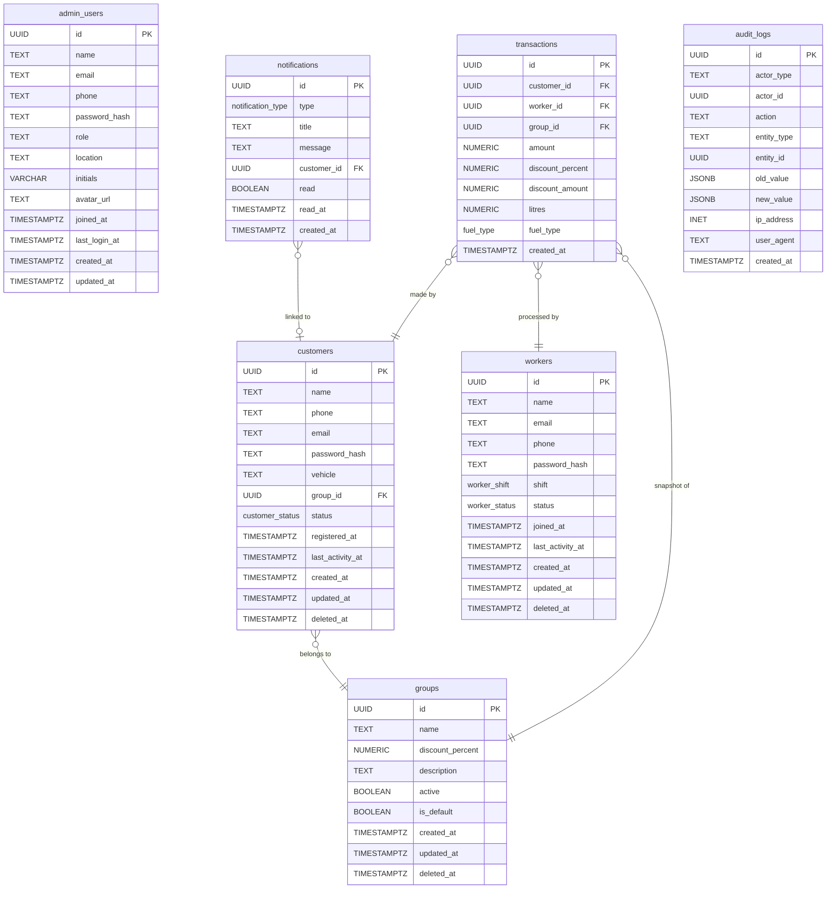

# FuelPoint — Database Schema Proposal (v1)

> **Status:** Draft for owner review — no SQL, no migration files, no code.  
> **Scope:** Admin panel data needs. Tables are designed to not block the worker or customer mobile apps.  
> **Date:** 2026-10-12

---

## 1. Page Inventory

### 1.1 Login page (`/`)

| Action | Data read | Data written | Source file |
|---|---|---|---|
| Sign in | Admin email + password (form only in mock) | Session token (currently `sessionStorage`) | `routes/index.tsx` |
| Forgot password | Admin email | (mocked — sends reset link) | `routes/index.tsx` |

**Entity / fields found:**

| Entity | Fields | File |
|---|---|---|
| AdminProfile (login context) | `email`, `password` (form input only) | `routes/index.tsx` |

---

### 1.2 Dashboard (`/dashboard`)

| Action | Data read | Data written |
|---|---|---|
| View stats | `customers`, `workers`, `groups`, `transactions` (all) | None |
| Filter by period | 7 / 30 / 90 days, derived client-side | None |

Derived metrics computed in `adminService.buildOverview()` and `buildSeries()`:

- `totalCustomers`, `totalWorkers`, `activeWorkers`, `totalGroups`
- `totalTransactions`, `totalDiscount`, `totalRevenue`
- `todayTransactions`, `todayDiscount`
- `newRegistrations7d`, `activeCustomers`, `usedPumpCustomers`, `unassignedCustomers`, `avgDiscountPercent`
- Time-series buckets: `transactions`, `discount`, `registrations`, `revenue` per day

**Source:** `routes/_admin.dashboard.tsx`, `services/adminService.ts`

---

### 1.3 Customers (`/customers`)

| Action | Data read | Data written |
|---|---|---|
| List / search / filter | `customers[]`, `groups[]`, `transactions[]` | None |
| View customer detail | Customer record + recent transactions for that customer | None |
| Create customer | Form fields | New customer record |
| Edit customer | Existing customer record | Updated customer record |
| Delete customer | Customer id | Customer removed |
| Assign to group (from detail) | `groups[]` | `customer.groupId`; also marks related `notifications` as read |
| Export CSV | Filtered customers | Local file download (no DB write) |

**Entity / fields:**

| Entity | Fields | File |
|---|---|---|
| Customer | `id`, `name`, `phone`, `email`, `vehicle`, `groupId`, `registeredAt`, `lastActivity`, `transactions`*, `totalSpend`*, `discountReceived`*, `status`, `password?` | `types.ts`, `_admin.customers.tsx` |

\* = denormalised aggregates (see §6)

**Filters:** group, status (`active` / `inactive` / `pending`), full-text on name / phone / id

---

### 1.4 Workers (`/workers`)

| Action | Data read | Data written |
|---|---|---|
| List / search / filter | `workers[]`, `transactions[]` | None |
| View worker detail | Worker record + recent transactions for that worker | None |
| Create worker | Form fields | New worker record |
| Edit worker | Existing worker record | Updated worker record |
| Delete worker | Worker id | Worker removed |

**Entity / fields:**

| Entity | Fields | File |
|---|---|---|
| Worker | `id`, `name`, `email`, `phone`, `password?`, `shift`, `status`, `joinedAt`, `scans`*, `customersScanned`*, `transactions`*, `discountProcessed`*, `lastActivity` | `types.ts`, `_admin.workers.tsx` |

\* = denormalised aggregates (see §6)

**Filters:** status (`active` / `offline` / `suspended`), shift (`Morning` / `Evening` / `Night`), full-text on name / id / email

---

### 1.5 Groups (`/groups`)

| Action | Data read | Data written |
|---|---|---|
| List all groups | `groups[]`, `customers[]`, `transactions[]` | None |
| Create group | — | New group record |
| Edit group | Existing group record | Updated group record (name, description, discount %) |
| Toggle active/inactive | Group id | `group.active` flipped |
| Delete group | Group id | Group removed; affected customers moved to default group |
| Assign customer to group | `customers[]` (sorted: unassigned first) | `customer.groupId` |

**Entity / fields:**

| Entity | Fields | File |
|---|---|---|
| Group | `id`, `name`, `discountPercent`, `description`, `active`, `createdAt`, `isDefault?` | `types.ts`, `mockData.ts`, `_admin.groups.tsx` |

**Computed per group (in `groupDistribution()`):** `customers` count, `transactions` count, `discountGenerated` sum.

---

### 1.6 Notifications (`/notifications`)

| Action | Data read | Data written |
|---|---|---|
| List all | `notifications[]`, `customers[]` | None |
| Mark single read | Notification id | `notification.read = true` |
| Mark all read | — | All `notification.read = true` |
| Open linked customer | `notification.customerId` | None (navigates to `/customers`) |

**Entity / fields:**

| Entity | Fields | File |
|---|---|---|
| Notification | `id`, `type` (`registration`/`group`/`worker`/`system`), `title`, `message`, `createdAt`, `read`, `customerId?` | `types.ts`, `_admin.notifications.tsx` |

**Filters:** all / unread / registration / system (no "worker" filter tab currently, but type exists in data)

---

### 1.7 Reports (`/reports`)

| Action | Data read | Data written |
|---|---|---|
| View summary stats | `transactions[]`, `customers[]`, `workers[]`, `groups[]` filtered to date range | None |
| Export CSV | Filtered rows | Local file download |

**Report categories:** Transactions, Discount, Customers (registrations in range), Workers, Groups

**Date ranges:** today, week, month, 90 days, custom (from/to)

**Metrics per transaction row:** `id`, `createdAt`, `customerName`, `workerName`, `fuel`, `litres`, `amount`, `discountPercent`, `discountAmount`

**Source:** `routes/_admin.reports.tsx`, `services/adminService.ts`

---

### 1.8 Profile (`/profile`)

| Action | Data read | Data written |
|---|---|---|
| View profile | `AdminProfile` | None |
| Update profile | Existing profile | `name`, `email`, `phone`, `location`, `initials` |
| Change password | Form (current, new, confirm) | Password (mocked — no actual DB write yet) |
| Avatar upload | — | (placeholder, not implemented) |

**Entity / fields:**

| Entity | Fields | File |
|---|---|---|
| AdminProfile | `name`, `email`, `phone`, `role`, `location`, `joinedAt`, `initials` | `types.ts`, `_admin.profile.tsx`, `mockData.ts` |

---

### 1.9 Search (`/search?q=`)

| Action | Data read | Data written |
|---|---|---|
| Full-text search | `customers[]` (name, phone, email), `workers[]` (name, phone, email) | None |

---

## 2. Proposed Tables

> **Conventions used throughout (see §5 for decisions):**
> - Primary keys: `UUID` generated by `gen_random_uuid()` (PG 13+)
> - All timestamps: `TIMESTAMPTZ`
> - Money: `NUMERIC(12,2)` (INR, two decimal places)
> - Discount percent: `NUMERIC(5,2)` (0.00–100.00)
> - Status / enum: PostgreSQL `ENUM` types (all defined below)
> - Soft delete: `deleted_at TIMESTAMPTZ NULL` on tables where history matters

---

### 2.1 `admin_users`

Stores admin panel login credentials and profile data. Currently there is exactly one admin ("Super Admin") but the table is designed to allow multiple admins with different roles.

**Justification:** `AdminProfile` in `types.ts`, login form in `routes/index.tsx`, profile page in `routes/_admin.profile.tsx`.

| Column | Type | Nullable | Default | Notes |
|---|---|---|---|---|
| `id` | `UUID` | NO | `gen_random_uuid()` | PK |
| `name` | `TEXT` | NO | — | Full name |
| `email` | `TEXT` | NO | — | Login credential; UNIQUE |
| `phone` | `TEXT` | YES | NULL | Contact; UNIQUE when not NULL |
| `password_hash` | `TEXT` | NO | — | bcrypt/argon2 hash — never plaintext |
| `role` | `TEXT` | NO | `'Super Admin'` | Free-text role label shown in UI |
| `location` | `TEXT` | YES | NULL | `profile.location` |
| `initials` | `VARCHAR(3)` | NO | — | Derived from name; stored for avatar display |
| `avatar_url` | `TEXT` | YES | NULL | Future avatar upload placeholder |
| `joined_at` | `TIMESTAMPTZ` | NO | `now()` | `AdminProfile.joinedAt` |
| `last_login_at` | `TIMESTAMPTZ` | YES | NULL | Set on each successful login |
| `created_at` | `TIMESTAMPTZ` | NO | `now()` | |
| `updated_at` | `TIMESTAMPTZ` | NO | `now()` | Update via trigger |

**Constraints:**
- `PK (id)`
- `UNIQUE (email)`
- `UNIQUE (phone) WHERE phone IS NOT NULL`

**Indexes:**
- `idx_admin_users_email` on `(email)` — login lookup

---

### 2.2 `groups`

Discount groups. New customers land in the default group until an admin assigns them.

**Justification:** `Group` interface in `types.ts`, `DEFAULT_GROUP_ID` in `types.ts` and `adminService.ts`, `routes/_admin.groups.tsx`.

| Column | Type | Nullable | Default | Notes |
|---|---|---|---|---|
| `id` | `UUID` | NO | `gen_random_uuid()` | PK |
| `name` | `TEXT` | NO | — | Group name; UNIQUE |
| `discount_percent` | `NUMERIC(5,2)` | NO | `0.00` | `Group.discountPercent`; CHECK 0–100 |
| `description` | `TEXT` | YES | NULL | `Group.description` |
| `active` | `BOOLEAN` | NO | `TRUE` | `Group.active` — can be toggled |
| `is_default` | `BOOLEAN` | NO | `FALSE` | Exactly one row must be TRUE; enforced at app layer |
| `created_at` | `TIMESTAMPTZ` | NO | `now()` | `Group.createdAt` |
| `updated_at` | `TIMESTAMPTZ` | NO | `now()` | |
| `deleted_at` | `TIMESTAMPTZ` | YES | NULL | Soft delete |

**Constraints:**
- `PK (id)`
- `UNIQUE (name) WHERE deleted_at IS NULL`
- `CHECK (discount_percent BETWEEN 0 AND 100)`

**Indexes:**
- `idx_groups_active` on `(active) WHERE deleted_at IS NULL`

**Delete behaviour:** When a group is deleted, all its customers are moved to the default group (done at application layer, not CASCADE). The `deleted_at` column allows the group name to be reused later.

---

### 2.3 `customers`

Registered customers who use the pump. Created initially by the mobile/QR registration flow (out of scope for this admin panel) or manually by an admin.

**Justification:** `Customer` interface in `types.ts`, `routes/_admin.customers.tsx`, `mockData.ts`.

| Column | Type | Nullable | Default | Notes |
|---|---|---|---|---|
| `id` | `UUID` | NO | `gen_random_uuid()` | PK |
| `name` | `TEXT` | NO | — | Full name |
| `phone` | `TEXT` | NO | — | UNIQUE; primary identifier on mobile |
| `email` | `TEXT` | YES | NULL | UNIQUE when not NULL |
| `password_hash` | `TEXT` | YES | NULL | Mobile app login — admin panel sets it via edit dialog |
| `vehicle` | `TEXT` | YES | NULL | Vehicle description (`Customer.vehicle`) |
| `group_id` | `UUID` | NO | *(default group id)* | FK → `groups(id)` |
| `status` | `customer_status` | NO | `'pending'` | `active` / `inactive` / `pending` |
| `registered_at` | `TIMESTAMPTZ` | NO | `now()` | `Customer.registeredAt` |
| `last_activity_at` | `TIMESTAMPTZ` | YES | NULL | `Customer.lastActivity`; updated when a transaction is processed |
| `created_at` | `TIMESTAMPTZ` | NO | `now()` | |
| `updated_at` | `TIMESTAMPTZ` | NO | `now()` | |
| `deleted_at` | `TIMESTAMPTZ` | YES | NULL | Soft delete |

**Enum:**
```sql
CREATE TYPE customer_status AS ENUM ('active', 'inactive', 'pending');
```

**Constraints:**
- `PK (id)`
- `UNIQUE (phone) WHERE deleted_at IS NULL`
- `UNIQUE (email) WHERE email IS NOT NULL AND deleted_at IS NULL`
- `FK group_id → groups(id) ON DELETE RESTRICT` (admin must reassign first)

**Indexes:**
- `idx_customers_phone` on `(phone)` — search + mobile lookup
- `idx_customers_email` on `(email) WHERE email IS NOT NULL`
- `idx_customers_group_status` on `(group_id, status)` — filter by group and status
- `idx_customers_registered_at` on `(registered_at DESC)` — new registrations report
- `idx_customers_last_activity` on `(last_activity_at DESC)` — dashboard "active" logic

**Note on `group_id` default:** The application sets this to the default group's UUID at insert time. The UUID of the default group must be known at application startup (looked up by `is_default = TRUE`).

---

### 2.4 `workers`

Pump attendants who scan customer QR codes and process fuel transactions.

**Justification:** `Worker` interface in `types.ts`, `routes/_admin.workers.tsx`, `mockData.ts`.

| Column | Type | Nullable | Default | Notes |
|---|---|---|---|---|
| `id` | `UUID` | NO | `gen_random_uuid()` | PK |
| `name` | `TEXT` | NO | — | Full name |
| `email` | `TEXT` | NO | — | UNIQUE; login credential for worker app |
| `phone` | `TEXT` | NO | — | UNIQUE; contact |
| `password_hash` | `TEXT` | YES | NULL | Worker app login — admin sets via edit dialog |
| `shift` | `worker_shift` | NO | — | `Morning` / `Evening` / `Night` |
| `status` | `worker_status` | NO | `'active'` | `active` / `offline` / `suspended` |
| `joined_at` | `TIMESTAMPTZ` | NO | `now()` | `Worker.joinedAt` |
| `last_activity_at` | `TIMESTAMPTZ` | YES | NULL | `Worker.lastActivity` |
| `created_at` | `TIMESTAMPTZ` | NO | `now()` | |
| `updated_at` | `TIMESTAMPTZ` | NO | `now()` | |
| `deleted_at` | `TIMESTAMPTZ` | YES | NULL | Soft delete |

**Enums:**
```sql
CREATE TYPE worker_shift  AS ENUM ('Morning', 'Evening', 'Night');
CREATE TYPE worker_status AS ENUM ('active', 'offline', 'suspended');
```

**Constraints:**
- `PK (id)`
- `UNIQUE (email) WHERE deleted_at IS NULL`
- `UNIQUE (phone) WHERE deleted_at IS NULL`

**Indexes:**
- `idx_workers_email` on `(email)` — worker app login
- `idx_workers_status_shift` on `(status, shift)` — filter panel

---

### 2.5 `transactions`

Each fuelling event: a worker scans a customer, fuel is dispensed, discount is applied.

**Justification:** `Transaction` interface in `types.ts`, `routes/_admin.reports.tsx`, `routes/_admin.dashboard.tsx`, customer / worker detail dialogs in `_admin.customers.tsx` and `_admin.workers.tsx`.

| Column | Type | Nullable | Default | Notes |
|---|---|---|---|---|
| `id` | `UUID` | NO | `gen_random_uuid()` | PK |
| `customer_id` | `UUID` | NO | — | FK → `customers(id)` |
| `worker_id` | `UUID` | NO | — | FK → `workers(id)` |
| `group_id` | `UUID` | NO | — | FK → `groups(id)` — group at time of transaction (snapshot) |
| `amount` | `NUMERIC(12,2)` | NO | — | Total charged in INR (`Transaction.amount`) |
| `discount_percent` | `NUMERIC(5,2)` | NO | `0.00` | Group discount at time of scan (snapshot) |
| `discount_amount` | `NUMERIC(12,2)` | NO | `0.00` | `amount × discount_percent / 100`; stored for auditability |
| `litres` | `NUMERIC(8,2)` | NO | — | Litres dispensed (`Transaction.litres`) |
| `fuel_type` | `fuel_type` | NO | — | `Petrol` / `Diesel` / `CNG` |
| `created_at` | `TIMESTAMPTZ` | NO | `now()` | Scan timestamp |

**Enum:**
```sql
CREATE TYPE fuel_type AS ENUM ('Petrol', 'Diesel', 'CNG');
```

**Constraints:**
- `PK (id)`
- `FK customer_id → customers(id) ON DELETE RESTRICT`
- `FK worker_id  → workers(id)  ON DELETE RESTRICT`
- `FK group_id   → groups(id)   ON DELETE RESTRICT`
- `CHECK (amount >= 0)`
- `CHECK (discount_percent BETWEEN 0 AND 100)`
- `CHECK (discount_amount >= 0)`
- `CHECK (litres > 0)`

**Indexes:**
- `idx_transactions_customer_created` on `(customer_id, created_at DESC)` — customer detail recent activity
- `idx_transactions_worker_created` on `(worker_id, created_at DESC)` — worker detail recent activity
- `idx_transactions_group_created` on `(group_id, created_at DESC)` — group report
- `idx_transactions_created_at` on `(created_at DESC)` — dashboard "today", report date filter

**No `customerName` / `workerName` columns:** Names are denormalised in the mock only for UI convenience. The real API will JOIN. The `group_id` and `discount_percent` columns *do* snapshot group data at scan time because the group's discount could change later.

---

### 2.6 `notifications`

Admin-facing event inbox. Created by backend event handlers (new registration, group change, worker suspension, system events).

**Justification:** `Notification` interface in `types.ts`, `routes/_admin.notifications.tsx`, `admin-store.tsx` (`markRead`, `markAllRead`, `unreadCount`).

| Column | Type | Nullable | Default | Notes |
|---|---|---|---|---|
| `id` | `UUID` | NO | `gen_random_uuid()` | PK |
| `type` | `notification_type` | NO | — | `registration` / `group` / `worker` / `system` |
| `title` | `TEXT` | NO | — | Short heading |
| `message` | `TEXT` | NO | — | Full body text |
| `customer_id` | `UUID` | YES | NULL | FK → `customers(id)` — links "Open customer" button |
| `read` | `BOOLEAN` | NO | `FALSE` | Per-admin read state |
| `read_at` | `TIMESTAMPTZ` | YES | NULL | Set when `read` changes to TRUE |
| `created_at` | `TIMESTAMPTZ` | NO | `now()` | |

**Enum:**
```sql
CREATE TYPE notification_type AS ENUM ('registration', 'group', 'worker', 'system');
```

**Constraints:**
- `PK (id)`
- `FK customer_id → customers(id) ON DELETE SET NULL`

**Indexes:**
- `idx_notifications_read_created` on `(read, created_at DESC)` — unread count + sorted list
- `idx_notifications_type_created` on `(type, created_at DESC)` — filter by type
- `idx_notifications_customer` on `(customer_id) WHERE customer_id IS NOT NULL`

> **Open question (§9 — Q3):** Notifications are currently global (one inbox, one admin). If multiple admins are added, a `notification_read_states` join table per admin user will be needed instead of `read` / `read_at` on this table.

---

### 2.7 `audit_logs`

Immutable record of every state-changing action. See §7 for full detail.

| Column | Type | Nullable | Default | Notes |
|---|---|---|---|---|
| `id` | `UUID` | NO | `gen_random_uuid()` | PK |
| `actor_type` | `TEXT` | NO | — | `'admin'` / `'worker'` / `'system'` |
| `actor_id` | `UUID` | YES | NULL | FK to `admin_users` or `workers` — NULL for system |
| `action` | `TEXT` | NO | — | e.g. `'customer.group_assigned'` |
| `entity_type` | `TEXT` | NO | — | e.g. `'customer'`, `'worker'`, `'group'` |
| `entity_id` | `UUID` | YES | NULL | PK of the affected row |
| `old_value` | `JSONB` | YES | NULL | Snapshot before change |
| `new_value` | `JSONB` | YES | NULL | Snapshot after change |
| `ip_address` | `INET` | YES | NULL | PG native type; requires PG 9.1+ |
| `user_agent` | `TEXT` | YES | NULL | |
| `created_at` | `TIMESTAMPTZ` | NO | `now()` | |

**Constraints:**
- `PK (id)`
- No FK on `actor_id` or `entity_id` — deliberate, so deleting a worker/customer does not cascade-delete the audit trail.

**Indexes:**
- `idx_audit_logs_actor` on `(actor_type, actor_id, created_at DESC)`
- `idx_audit_logs_entity` on `(entity_type, entity_id, created_at DESC)`
- `idx_audit_logs_action_created` on `(action, created_at DESC)`
- `idx_audit_logs_created_at` on `(created_at DESC)`

---

## 3. Comparison with Owner's List

| Owner's table | Status | Notes |
|---|---|---|
| `customers` | ✅ Confirmed | Proposed as `customers` (§2.3) |
| `workers` | ✅ Confirmed | Proposed as `workers` (§2.4) |
| `users` | ⚠️ Ambiguous | See §4 for two designs. The code shows a single admin profile; "users" likely means admin login accounts. Could also be a unified table for admins + workers + customers. |
| `notifications` | ✅ Confirmed | Proposed as `notifications` (§2.6) |
| `transactions` | ✅ Confirmed | Proposed as `transactions` (§2.5) |
| `audit_logs` | ✅ Confirmed | Proposed as `audit_logs` (§2.7) |

**Tables in the code that are NOT in the owner's list:**

| Table | Reason needed |
|---|---|
| `groups` | Core entity — every customer has a `groupId`; every transaction snapshots `groupId` and `discountPercent`. The `groups` page is a primary navigation item. |
| `admin_users` | The login page, profile page, and `adminService.getProfile()` all expose an admin entity with its own password, name, role, location, and joined date. Whether this is the "users" table the owner mentioned is clarified in §4. |

---

## 4. The "users" Table — Two Designs

The owner mentioned a `users` table without specifying intent. The code reveals:

- `AdminProfile` (one record, `name`, `email`, `phone`, `role`, `location`, `joinedAt`, `initials`)
- `Customer` has a `password?` field — suggesting customers log into the mobile app
- `Worker` has a `password?` field — suggesting workers log into the worker app

This gives two meaningful interpretations.

---

### Design A — Separate tables per role (recommended)

Three separate login tables: `admin_users`, `customers`, `workers`. Each table carries its own credential and profile columns.

```
admin_users   (id, email, password_hash, role, ...)
customers     (id, phone, email, password_hash, group_id, ...)
workers       (id, email, phone, password_hash, shift, ...)
```

**Trade-offs:**

| Pros | Cons |
|---|---|
| Each table matches exactly the data its role needs; no nullable columns forced on unrelated roles | Three separate auth flows, three credential checks |
| Schema change to one role never touches others | If a future requirement makes someone both a worker and a customer, the schema doesn't support it easily |
| Queries stay simple — no discriminator column needed | |
| Foreign keys on transactions, notifications, and audit_logs are unambiguous | |
| Mobile app (customer) and worker app don't share credentials with the admin panel | |

---

### Design B — Single `users` table with role column

```
users  (id, email, phone, password_hash, role enum('admin','worker','customer'), ...)
customer_profiles  (user_id FK, group_id, vehicle, ...)
worker_profiles    (user_id FK, shift, ...)
admin_profiles     (user_id FK, location, role_label, ...)
```

**Trade-offs:**

| Pros | Cons |
|---|---|
| Single auth query regardless of role | Many nullable columns or three extra profile tables |
| Easy to query "all logins" or check if an email is in use across any role | `NOT NULL` enforcement on role-specific fields becomes application-level |
| Could share phone/email uniqueness across the entire system | A worker with the same email as a customer would be blocked — may or may not be desired |
| Standard pattern for SaaS multi-role products | Adds join complexity for every customer or worker lookup |

---

### Recommendation

**Design A (separate tables).** The three roles have very different data shapes. Customers need `group_id`, `vehicle`, and `registered_at`. Workers need `shift` and `joined_at`. Admins need `location`, `role` label, and `initials`. The overlap is small (name, email, phone, password). Design A keeps each table simple and avoids nullable-column sprawl. If the owner's intent for "users" was specifically admin logins, `admin_users` alone satisfies that.

This recommendation is **not final** — the owner should confirm whether the mobile apps will share a single authentication service or have separate auth endpoints (see Open Questions §9 — Q1).

---

## 5. Cross-Cutting Decisions

### 5.1 ID type

| Option | Pros | Cons |
|---|---|---|
| `UUID` (`gen_random_uuid()`, PG 13+) | No sequential guessing; safe to expose in URLs and APIs; works well in distributed inserts from mobile | Larger storage (16 bytes vs 8); slightly slower B-tree index on very large tables |
| `BIGINT` / `SERIAL` | Smaller; faster range scans; human-readable in logs | Sequential — IDs are guessable; awkward if mobile apps insert without going through a central sequence |

**Recommendation: UUID.** The worker and customer mobile apps will also create records (transactions, customer registrations). UUIDs let each app generate its own ID without a round-trip to get the next sequence value. `gen_random_uuid()` is built in from PG 13.

> **PostgreSQL note:** `gen_random_uuid()` requires **PostgreSQL 13 or later**. If an older version must be supported, use the `pgcrypto` extension (`uuid_generate_v4()`).

---

### 5.2 Timestamps

**Decision: `TIMESTAMPTZ` everywhere.** The mock data stores ISO strings with UTC offsets. The pump operates in a single time zone (India, IST = UTC+5:30), but `TIMESTAMPTZ` stores the absolute moment and lets any client display in its local zone. `TIMESTAMP WITHOUT TIME ZONE` discards zone information and creates ambiguity during DST transitions.

All `created_at` / `updated_at` columns default to `now()`. An `updated_at` trigger (one per table) is the cleanest way to maintain this automatically without relying on the application layer.

---

### 5.3 Money and numeric precision

| Field | Proposed type | Justification |
|---|---|---|
| `amount`, `discount_amount` | `NUMERIC(12,2)` | INR, two decimal places; max 9,999,999,999.99 — sufficient for any single transaction |
| `discount_percent` | `NUMERIC(5,2)` | Range 0.00–100.00; mock uses 0, 1, 1.5, 2, 2.5, 3 |
| `litres` | `NUMERIC(8,2)` | Two decimals; mock computes `Math.round(amount/104 * 10)/10` so one decimal in practice, two are safe |

**Never use `FLOAT` or `DOUBLE PRECISION` for money** — binary floating-point arithmetic introduces rounding errors.

---

### 5.4 Status / enum fields

Three options:

| Option | Pros | Cons |
|---|---|---|
| PostgreSQL `ENUM` type | Type-safe at DB level; compact storage; clear intent | Adding a new value requires `ALTER TYPE … ADD VALUE` (non-transactional in PG < 12; fine in PG 12+); hard to rename values |
| `TEXT` + `CHECK` constraint | Easy to add/remove values with a migration; self-documenting | No compile-time type safety in DB; slightly more verbose |
| Lookup table | Fully relational; FK ensures referential integrity; easy to add values | Extra JOIN on every query; overkill for 2–4 values |

**Recommendation: PostgreSQL `ENUM` for well-known closed sets** (`customer_status`, `worker_status`, `worker_shift`, `fuel_type`, `notification_type`). These values are deeply embedded in the UI code and unlikely to expand often. Adding a new fuel type (e.g., Electric) or a new shift requires a planned migration anyway.

> **PostgreSQL note:** `ALTER TYPE … ADD VALUE` has been safe in a transaction since **PostgreSQL 12**. Renaming enum values requires **PostgreSQL 15** (`ALTER TYPE … RENAME VALUE`).

---

### 5.5 Soft delete vs hard delete

**Recommendation: soft delete (`deleted_at TIMESTAMPTZ NULL`) on `customers`, `workers`, and `groups`.**

- The mock's `deleteCustomer` and `deleteWorker` actions remove the record entirely from the in-memory array. In production, hard deletion would orphan `transactions` and `audit_logs`.
- `transactions` should **never** be soft-deleted — they are a financial record. Hard delete should be blocked at the application level.
- `notifications` can be hard-deleted (no FK dependencies; no financial significance).
- `audit_logs` must never be deleted.

All soft-delete indexes should use `WHERE deleted_at IS NULL` partial indexes for performance.

---

### 5.6 Password storage

**The frontend mock stores password as a plain string (`Customer.password?`, `Worker.password?`). This must never reach the database.**

**Decision: Store only the hash, never the plaintext.**

- Use **bcrypt** (cost factor ≥ 12) or **Argon2id** (recommended by OWASP 2024). Argon2id is available in Node.js via `@node-rs/argon2` or `argon2`.
- The `password?` field in the TypeScript types is an input-only field: the API layer accepts it, hashes it, stores the hash, and never returns it.
- The column is named `password_hash TEXT` in all three actor tables.
- For password resets: store a time-limited, single-use token — do not email the password.

---

### 5.7 Uniqueness of phone and email

**Customers:**
- `phone` — `UNIQUE NOT NULL`. The mobile app identifies customers by phone number.
- `email` — `UNIQUE NULLABE`. The mock generates `@mail.com` emails but some real customers may not have one.

**Workers:**
- `email` — `UNIQUE NOT NULL`. Used for worker app login.
- `phone` — `UNIQUE NOT NULL`. Contact field; also used for mobile app login in some setups.

**Admin users:**
- `email` — `UNIQUE NOT NULL`. Admin login.
- `phone` — `UNIQUE NULLABLE`.

Cross-table uniqueness (e.g., a customer and a worker sharing an email address): **not enforced at the DB level in Design A**. This is an open question (see §9 — Q2).

---

### 5.8 Default group behaviour

The code uses `DEFAULT_GROUP_ID = "grp-default"` as a sentinel for "unassigned customers". Key observations:

- New customers are placed in the default group automatically.
- The default group has `discountPercent: 0`.
- The groups page shows a count of "unassigned customers" as customers whose `groupId === DEFAULT_GROUP_ID`.
- The default group cannot be deleted (the `deleteGroup` handler in the mock moves members out, but the `!group.isDefault` guard in the UI prevents the delete button from rendering for the default group).
- The admin can assign customers *from* the default group to another group (this is the primary notification-driven workflow).

**Schema consequence:** The default group is a regular row in `groups` with `is_default = TRUE`. The application enforces "exactly one default group" and "default group cannot be deleted". A `CHECK` constraint cannot easily enforce the "exactly one" rule; use a `UNIQUE INDEX ON groups(is_default) WHERE is_default = TRUE` (partial unique index).

---

## 6. Derived Values

The mock stores several aggregates directly on entity objects. This section analyses each.

### 6.1 `Customer.transactions` (count of transactions for this customer)

| Option | Pros | Cons |
|---|---|---|
| **Compute** (`COUNT(*)` from `transactions`) | Always accurate; no sync needed | Adds a subquery or aggregate to customer list queries |
| Store (denormalised counter) | Fast reads without JOIN | Can drift if transactions are inserted/deleted without updating the counter; complex to keep correct |

**Recommendation: Compute.** A `COUNT` per customer is cheap with the index `idx_transactions_customer_created`. For the customer list page, a single query with a `LEFT JOIN … GROUP BY` or a PostgreSQL lateral join is straightforward. The customer detail view already filters `transactions WHERE customer_id = ?`.

---

### 6.2 `Customer.totalSpend` (sum of `amount` for this customer)

**Recommendation: Compute** (`SUM(amount) FROM transactions WHERE customer_id = ?`). Same reasoning as above.

---

### 6.3 `Customer.discountReceived` (sum of `discount_amount` for this customer)

**Recommendation: Compute** (`SUM(discount_amount) FROM transactions WHERE customer_id = ?`). Note that the mock recalculates this when a customer is moved to a new group: `discountReceived = Math.round(totalSpend * newGroup.discountPercent / 100)`. This recalculation is *wrong* in a real system — the historical discount already given in past transactions is fixed. The database stores the actual discount per transaction in `transactions.discount_amount`; the sum of that column is the true figure.

---

### 6.4 `Worker.scans` (total scans processed by this worker)

**Recommendation: Compute** (`COUNT(*) FROM transactions WHERE worker_id = ?`). One scan = one transaction row.

---

### 6.5 `Worker.customersScanned` (distinct customers scanned by this worker)

**Recommendation: Compute** (`COUNT(DISTINCT customer_id) FROM transactions WHERE worker_id = ?`). Slightly heavier but still index-friendly.

---

### 6.6 `Worker.transactions` (same as scans in mock — `COUNT(*)`)

In the mock, `transactions` ≈ `scans × (0.8–0.98)` (a fraction of scans result in a paid transaction). This implies the system may distinguish "scan" events from "completed transaction" events. If a scan can fail (customer not found, payment declined), a `scan_events` table separate from `transactions` may be needed.

**Open question (§9 — Q4).** Until clarified, compute both from `transactions`.

---

### 6.7 `Worker.discountProcessed` (sum of discount amounts for this worker)

**Recommendation: Compute** (`SUM(discount_amount) FROM transactions WHERE worker_id = ?`).

---

### 6.8 Summary: store vs compute

| Aggregate | Decision | Rationale |
|---|---|---|
| `customer.transactions` | Compute | Cheap index scan; no sync risk |
| `customer.totalSpend` | Compute | Correct at all times; no sync |
| `customer.discountReceived` | Compute | Mock's recalculation on group change is semantically wrong; DB sum is accurate |
| `customer.lastActivity` | **Store** on `customers.last_activity_at` | Needed for filtering/sorting; cheap to update on transaction insert |
| `worker.scans` | Compute | = `COUNT(*)` in `transactions` |
| `worker.customersScanned` | Compute | = `COUNT(DISTINCT customer_id)` in `transactions` |
| `worker.transactions` | Compute (pending scan vs txn clarification — Q4) | |
| `worker.discountProcessed` | Compute | = `SUM(discount_amount)` in `transactions` |
| `worker.lastActivity` | **Store** on `workers.last_activity_at` | Updated on each transaction insert; needed for sort/filter |

If report query performance becomes a concern for very large transaction volumes, a **materialised view** or **nightly aggregation table** is the right escalation path — not denormalised columns on the live entity tables.

---

## 7. `audit_logs` — What to Log

### 7.1 Actions that should be logged

| Actor | Action | `action` string | Notable fields |
|---|---|---|---|
| Admin | Login | `admin.login` | actor_id, ip_address, user_agent |
| Admin | Login failed | `admin.login_failed` | actor_id (if email found), ip_address |
| Admin | Logout | `admin.logout` | actor_id |
| Admin | Password changed (own) | `admin.password_changed` | actor_id |
| Admin | Profile updated | `admin.profile_updated` | old_value, new_value |
| Admin | Customer created | `customer.created` | entity_id, new_value |
| Admin | Customer edited | `customer.updated` | entity_id, old_value, new_value |
| Admin | Customer deleted (soft) | `customer.deleted` | entity_id, old_value |
| Admin | Customer group assigned | `customer.group_assigned` | entity_id, old_value.group_id, new_value.group_id |
| Admin | Worker created | `worker.created` | entity_id, new_value |
| Admin | Worker edited | `worker.updated` | entity_id, old_value, new_value |
| Admin | Worker deleted (soft) | `worker.deleted` | entity_id, old_value |
| Admin | Worker suspended | `worker.suspended` | entity_id, old_value.status, new_value.status |
| Admin | Group created | `group.created` | entity_id, new_value |
| Admin | Group updated | `group.updated` | entity_id, old_value, new_value |
| Admin | Group activated/deactivated | `group.toggled` | entity_id, new_value.active |
| Admin | Group deleted | `group.deleted` | entity_id, old_value |
| Admin | Notification marked read | `notification.read` | entity_id |
| Admin | All notifications marked read | `notification.all_read` | — |
| System | Transaction created (by worker app) | `transaction.created` | entity_id, new_value |
| System | Notification created | `notification.created` | entity_id, new_value |
| Worker | Scan processed (by worker app) | `scan.processed` | entity_id, actor_id (worker) |

### 7.2 What NOT to log

- Read-only operations (list views, dashboard, reports). These create excessive noise.
- Export CSV (client-side only in the current mock; if server-side export is added later, log it).

### 7.3 Table structure

See §2.7 above. Key design choices:

- `old_value` / `new_value` as `JSONB` — stores a snapshot of the relevant fields, not the entire row, to keep logs compact. The application layer decides what fields to include.
- No FK on `actor_id` or `entity_id` — audit history survives entity deletion.
- `actor_type TEXT` allows future system/cron actors without an enum migration.
- Logs are append-only. No `UPDATE` or `DELETE` ever touches this table (enforce via a role with `INSERT`-only privileges on this table, or a DB trigger that raises an exception on `UPDATE`/`DELETE`).

---

## 8. ER Diagram



---

## 9. Open Questions

1. **Authentication architecture** — Will the admin panel, worker app, and customer mobile app share a single authentication service, or will each have its own auth endpoint? This determines whether Design A (separate tables) or Design B (unified `users` table) is correct. If all three apps share one token endpoint, a unified `users` table (Design B) is strongly preferable.

2. **Cross-table email/phone uniqueness** — Should the system prevent a customer and a worker from sharing the same phone number or email address? If yes, a unified identity layer (Design B) or cross-table trigger/constraint is needed.

3. **Multi-admin support** — The mock has exactly one admin ("Rajesh Menon, Super Admin"). Should the `admin_users` table support multiple admins? If yes, the `notifications.read` column must become a per-admin read state (a separate `notification_reads(notification_id, admin_user_id, read_at)` join table). If it will always be single-admin, the current `read` column is fine.

4. **Scans vs transactions** — In the mock, `Worker.scans` and `Worker.transactions` are distinct (scans ≈ 1.05× transactions). Does a "scan" differ from a completed "transaction"? If so, a separate `scan_events` table is needed to record scan attempts that didn't result in a fuel transaction (e.g., customer identified but no fuel dispensed, or scan failed).

5. **Transaction immutability** — Can a transaction ever be voided, reversed, or amended after creation? If yes, a `transaction_adjustments` table or a `voided_at` column is needed. If transactions are always final, no change is required.

6. **Fuel price per litre** — The mock computes `litres = amount / 104`. Is `104` a fixed constant or a variable fuel price that needs to be stored? If fuel prices change, a `fuel_prices(fuel_type, price_per_litre, effective_from)` table is needed, and `transactions.litres` should be stored (not derived).

7. **`Customer.vehicle` type** — The mock stores vehicle as a free-text string (`"Maruti Swift"`, `"Ashok Leyland Truck"`). Should this be structured (make, model, registration plate, vehicle type)? A vehicle registration plate would be a natural secondary lookup key for customers at the pump.

8. **Default group identity** — The mock uses a hardcoded string ID (`"grp-default"`). In the database, the default group will have a UUID. How will the application resolve the default group's UUID at startup? Options: environment variable, a `settings` table, or always query `SELECT id FROM groups WHERE is_default = TRUE`.

9. **`AdminProfile.role` field** — The mock has `role: "Super Admin"` as a free-text label shown in the UI. Is this meant to be a permission level (controlling what pages or actions the admin can access), or purely a display label? If the former, a `roles` and `permissions` table is needed.

10. **Password reset flow** — The login page shows a "Forgot password?" dialog that says it will email a reset link. Where are reset tokens stored? A `password_reset_tokens(id, admin_user_id, token_hash, expires_at, used_at)` table is implied but not yet in scope.

11. **Report data freshness** — The current reports are computed in real time from raw transactions. At what scale should the system consider pre-aggregating data (materialised view, daily rollup table)? The owner should indicate the expected transaction volume per day.

---

*End of proposal. Awaiting owner review.*
