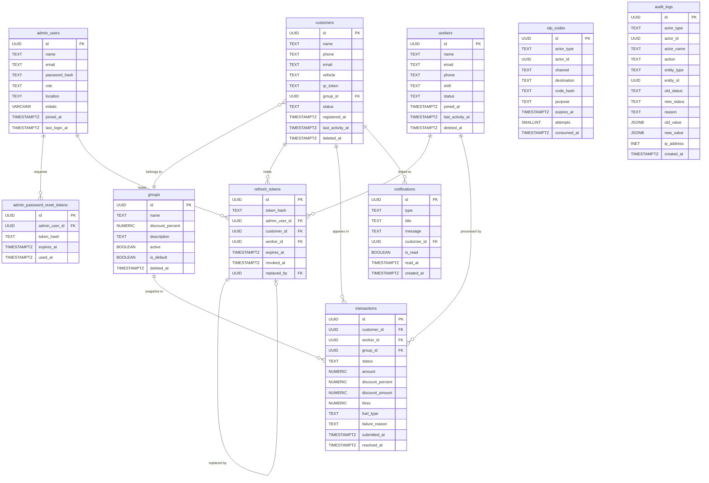

# FuelPoint — Database Schema Proposal (v2)

> **Status:** Draft for owner review — no SQL, no migration files, no code changes.  
> **Scope:** Admin panel + worker mobile API + customer mobile API. One fuel station.  
> **Date:** 2026-10-12  
> **Supersedes:** `docs/db-schema-proposal-v1.md`

---

## 0. Decision Log

| # | Decision | Status | Source |
|---|---|---|---|
| D01 | One fuel station only — no `stations` table | DECIDED | Owner |
| D02 | Backend serves three clients: admin web panel, worker app, customer app. Mobile screens are not ours; their APIs are. | DECIDED | Owner |
| D03 | Separate tables per role: `admin_users`, `customers`, `workers`. Same phone or email may exist in both customers and workers — no cross-table uniqueness. | DECIDED | Owner |
| D04 | Customers and workers authenticate by OTP only — no `password_hash` on those tables. | DECIDED | Owner |
| D05 | OTP is delivered by SMS now; design for both SMS and email channels. | DECIDED | Owner |
| D06 | Only the admin has a password, a forgot-password flow, and a change-password screen. | DECIDED | Owner |
| D07 | Auth tokens: short-lived access token (not stored) + stored refresh token hashed in a single `refresh_tokens` table. Logout and "log out of all devices" must work. | DECIDED | Owner |
| D08 | Admin role is a display label only. No roles table, no permissions table. Only one admin exists but design must not block more. | DECIDED | Owner |
| D09 | Customer status: `active` / `inactive` only — no `pending`. Set manually by admin. | DECIDED | Owner |
| D10 | New customer is `active` immediately, placed in default group (0 %). | DECIDED | Owner |
| D11 | Inactive customer's scan is rejected; reason recorded. | DECIDED | Owner |
| D12 | Customers: soft delete, keep all data. | DECIDED | Owner |
| D13 | Customer vehicle: one optional free-text field. | DECIDED | Owner |
| D14 | Customer QR: encodes a separate random token stored on the customer row — not the DB id. Only the customer can regenerate; old token stops immediately. No admin regenerate button. | DECIDED | Owner |
| D15 | Worker status: `active` / `offline` / `suspended` — always set by admin. Suspended worker cannot log in or submit transactions. | DECIDED | Owner |
| D16 | Workers: soft delete, keep all data. | DECIDED | Owner |
| D17 | Transaction flow: worker scans QR → prefilled form → worker enters amount → worker marks success or failed. | DECIDED | Owner |
| D18 | `amount` is price BEFORE discount. Customer pays `amount − discount_amount`. System calculates discount from customer's group. No fuel price table. | DECIDED | Owner |
| D19 | Transaction status: `pending` → `success` or `failed`. Worker can change result later. Never auto-fails. | DECIDED | Owner |
| D20 | Failed transaction: new QR scan creates a NEW transaction; old one stays `failed`. | DECIDED | Owner |
| D21 | `litres` and `fuel_type` are optional — stored only if the worker fills them. | DECIDED | Owner |
| D22 | Optional failure reason (free text by the worker). | DECIDED | Owner |
| D23 | Revenue, discount and customer-spend totals count `success` transactions only. | DECIDED | Owner |
| D24 | Worker "scans" = all submitted transactions (any status). Worker "transactions" = successful ones. Rejected scans (before a transaction exists) are NOT counted. | DECIDED | Owner |
| D25 | Rejected scan (e.g. inactive customer) creates no transaction row; logged in `audit_logs` with reason. Admin panel must be able to show these. | DECIDED | Owner |
| D26 | Notifications: simple `is_read` flag on the row (single admin). No per-admin read table for now. | DECIDED | Owner |
| D27 | No fuel price table, no vehicles table. | DECIDED | Owner |
| D28 | ID type: `UUID` via `gen_random_uuid()` (PG ≥ 13) or `pgcrypto`'s `uuid_generate_v4()` (PG < 13). | PROPOSED — needs owner confirmation | v1 analysis |
| D29 | All timestamps: `TIMESTAMPTZ`. | PROPOSED — needs owner confirmation | v1 analysis |
| D30 | Money: `NUMERIC(12,2)`. Discount percent: `NUMERIC(5,2)`. Litres: `NUMERIC(8,2)`. | PROPOSED — needs owner confirmation | v1 analysis |
| D31 | Discount rounding: `ROUND(amount × discount_percent / 100, 2)` — two decimal places. | PROPOSED — needs owner confirmation | Open question Q1 |
| D32 | Status / enum columns: PostgreSQL `ENUM` types. | PROPOSED — needs owner confirmation | v1 analysis |
| D33 | Groups: soft delete (open question Q5). | PROPOSED — needs owner confirmation | Open question Q5 |

---

## 1. Table Overview

Ten tables are proposed. The table list with justification:

| Table | Purpose | Justification |
|---|---|---|
| `admin_users` | Admin login and profile | Login page, profile page — `types.ts`, `routes/index.tsx`, `routes/_admin.profile.tsx` |
| `admin_password_reset_tokens` | Forgot-password flow for admin only | Login page "Forgot password?" — `routes/index.tsx`; D06 |
| `groups` | Discount groups; customers belong to one | `types.ts` `Group`; `routes/_admin.groups.tsx`; D10 |
| `customers` | Registered customers; OTP auth | `types.ts` `Customer`; `routes/_admin.customers.tsx`; D03, D04 |
| `workers` | Pump attendants; OTP auth | `types.ts` `Worker`; `routes/_admin.workers.tsx`; D03, D04 |
| `otp_codes` | One-time passcodes for customer and worker login | D04, D05 |
| `refresh_tokens` | Stored refresh tokens for all three actor types | D07 |
| `transactions` | Fuel scan events with status lifecycle | `types.ts` `Transaction`; `routes/_admin.reports.tsx`; D17–D24 |
| `notifications` | Admin inbox for events needing attention | `types.ts` `Notification`; `routes/_admin.notifications.tsx`; D26 |
| `audit_logs` | Immutable record of all state changes and rejected scans | `routes/_admin.reports.tsx` (to be added); D25 |

---

## 2. Tables

> **Conventions (see §7 for full discussion):**
> - Primary keys: `UUID` via `gen_random_uuid()` — PROPOSED D28
> - All timestamps: `TIMESTAMPTZ` — PROPOSED D29
> - Money: `NUMERIC(12,2)`; percent: `NUMERIC(5,2)`; litres: `NUMERIC(8,2)` — PROPOSED D30
> - Enums: PostgreSQL `ENUM` types — PROPOSED D32
> - `updated_at` maintained by a database trigger on each table

---

### 2.1 `admin_users`

**Purpose:** Stores the admin panel login credentials and profile. Exactly one row exists today; the table is designed to accommodate more without schema changes.

**Justification:** D06, D08. `AdminProfile` interface in `types.ts`; login form in `routes/index.tsx`; profile page in `routes/_admin.profile.tsx`.

| Column | Type | Nullable | Default | Notes |
|---|---|---|---|---|
| `id` | `UUID` | NO | `gen_random_uuid()` | PK |
| `name` | `TEXT` | NO | — | Full name |
| `email` | `TEXT` | NO | — | Login credential. UNIQUE. |
| `phone` | `TEXT` | YES | NULL | Contact. UNIQUE when not NULL. |
| `password_hash` | `TEXT` | NO | — | Argon2id or bcrypt. Never plaintext. |
| `role` | `TEXT` | NO | `'Super Admin'` | Display label only. D08. |
| `location` | `TEXT` | YES | NULL | `AdminProfile.location` |
| `initials` | `VARCHAR(3)` | NO | — | Derived from name on save; stored for avatar display |
| `avatar_url` | `TEXT` | YES | NULL | Future upload placeholder |
| `joined_at` | `TIMESTAMPTZ` | NO | `now()` | `AdminProfile.joinedAt` |
| `last_login_at` | `TIMESTAMPTZ` | YES | NULL | Set on each successful login |
| `created_at` | `TIMESTAMPTZ` | NO | `now()` | |
| `updated_at` | `TIMESTAMPTZ` | NO | `now()` | Maintained by trigger |

**Primary key:** `(id)`

**Unique constraints:**
- `UNIQUE (email)`
- `UNIQUE (phone) WHERE phone IS NOT NULL`

**Indexes:**
- `idx_admin_users_email` on `(email)` — login lookup

**Notes:** No `deleted_at` — a deactivated admin should have their password invalidated and be locked out via application logic rather than soft-deleted, to avoid confusion with auth state. This is PROPOSED and the owner should confirm.

---

### 2.2 `admin_password_reset_tokens`

**Purpose:** Stores time-limited, single-use tokens emailed to the admin for password reset. Separate from `refresh_tokens` because the reset flow is email-based and pre-authentication.

**Justification:** D06. Login page "Forgot password?" dialog in `routes/index.tsx`.

| Column | Type | Nullable | Default | Notes |
|---|---|---|---|---|
| `id` | `UUID` | NO | `gen_random_uuid()` | PK |
| `admin_user_id` | `UUID` | NO | — | FK → `admin_users(id)` ON DELETE CASCADE |
| `token_hash` | `TEXT` | NO | — | SHA-256 hash of the emailed token. Never store plaintext. |
| `expires_at` | `TIMESTAMPTZ` | NO | — | PROPOSED default: `now() + interval '1 hour'` |
| `used_at` | `TIMESTAMPTZ` | YES | NULL | Set when token is consumed; NULL = not yet used |
| `created_at` | `TIMESTAMPTZ` | NO | `now()` | |

**Primary key:** `(id)`

**Foreign keys:**
- `admin_user_id → admin_users(id) ON DELETE CASCADE`

**Indexes:**
- `idx_admin_pw_reset_user` on `(admin_user_id, expires_at DESC)` — look up unused tokens per user
- `idx_admin_pw_reset_token` on `(token_hash)` — look up by token value (for verification)

**Notes:**
- The application invalidates all tokens for a user when a new one is created (one active reset at a time — PROPOSED).
- Token expiry: PROPOSED 1 hour (open question Q6).
- Expired and used tokens can be hard-deleted by a cleanup job.

---

### 2.3 `groups`

**Purpose:** Discount groups. Every customer belongs to exactly one group. New customers land in the default group (0 % discount) until the admin reassigns them.

**Justification:** D10, D23. `Group` interface in `types.ts`; `DEFAULT_GROUP_ID` constant in `types.ts` and `adminService.ts`; `routes/_admin.groups.tsx`.

| Column | Type | Nullable | Default | Notes |
|---|---|---|---|---|
| `id` | `UUID` | NO | `gen_random_uuid()` | PK |
| `name` | `TEXT` | NO | — | Unique within non-deleted groups |
| `discount_percent` | `NUMERIC(5,2)` | NO | `0.00` | `Group.discountPercent`. CHECK 0–100. |
| `description` | `TEXT` | YES | NULL | `Group.description` |
| `active` | `BOOLEAN` | NO | `TRUE` | Inactive group still holds members but no new assignment |
| `is_default` | `BOOLEAN` | NO | `FALSE` | Exactly one live row must be TRUE |
| `created_at` | `TIMESTAMPTZ` | NO | `now()` | `Group.createdAt` |
| `updated_at` | `TIMESTAMPTZ` | NO | `now()` | Maintained by trigger |
| `deleted_at` | `TIMESTAMPTZ` | YES | NULL | Soft delete — PROPOSED D33 |

**Primary key:** `(id)`

**Unique constraints:**
- `UNIQUE (name) WHERE deleted_at IS NULL` — allows name reuse after deletion
- `UNIQUE (is_default) WHERE is_default = TRUE AND deleted_at IS NULL` — enforces exactly one live default group

**Check constraints:**
- `CHECK (discount_percent BETWEEN 0 AND 100)`

**Foreign keys:** none (customers FK to this table)

**Indexes:**
- `idx_groups_active` on `(active) WHERE deleted_at IS NULL`

**Delete behaviour:** When a group is deleted, all its members are moved to the default group at the application layer before setting `deleted_at`. The default group (`is_default = TRUE`) cannot be deleted — enforced at the application layer.

---

### 2.4 `customers`

**Purpose:** Registered customers who use the pump. Login via OTP only. The admin panel can create, edit, and soft-delete customers.

**Justification:** D03, D04, D09–D14. `Customer` interface in `types.ts`; `routes/_admin.customers.tsx`.

| Column | Type | Nullable | Default | Notes |
|---|---|---|---|---|
| `id` | `UUID` | NO | `gen_random_uuid()` | PK |
| `name` | `TEXT` | NO | — | Full name |
| `phone` | `TEXT` | NO | — | Primary login identifier. UNIQUE (non-deleted). |
| `email` | `TEXT` | YES | NULL | Optional. UNIQUE when not NULL (non-deleted). |
| `vehicle` | `TEXT` | YES | NULL | Free-text vehicle description. D13. |
| `qr_token` | `TEXT` | NO | — | Random opaque token encoded in the QR code. UNIQUE. NOT the `id`. D14. |
| `group_id` | `UUID` | NO | — | FK → `groups(id)` ON DELETE RESTRICT. Default group at registration. |
| `status` | `customer_status` | NO | `'active'` | `active` / `inactive`. Set by admin. D09, D10. |
| `registered_at` | `TIMESTAMPTZ` | NO | `now()` | |
| `last_activity_at` | `TIMESTAMPTZ` | YES | NULL | Updated on each successful (status = success) transaction. PROPOSED — see §6. |
| `created_at` | `TIMESTAMPTZ` | NO | `now()` | |
| `updated_at` | `TIMESTAMPTZ` | NO | `now()` | Maintained by trigger |
| `deleted_at` | `TIMESTAMPTZ` | YES | NULL | Soft delete. D12. |

**Enum:**
```
customer_status: 'active', 'inactive'
```
*(v1 had 'pending' — removed per D09)*

**Primary key:** `(id)`

**Unique constraints:**
- `UNIQUE (phone) WHERE deleted_at IS NULL`
- `UNIQUE (email) WHERE email IS NOT NULL AND deleted_at IS NULL`
- `UNIQUE (qr_token)` — global, not filtered; an old token must not match even for a deleted customer

**Foreign keys:**
- `group_id → groups(id) ON DELETE RESTRICT` — admin must reassign before deleting a group

**Check constraints:**
- `CHECK (status IN ('active', 'inactive'))` — redundant given the ENUM but useful for documentation

**Indexes:**
- `idx_customers_phone` on `(phone) WHERE deleted_at IS NULL` — OTP lookup + search
- `idx_customers_email` on `(email) WHERE email IS NOT NULL AND deleted_at IS NULL`
- `idx_customers_qr_token` on `(qr_token)` — worker app QR scan lookup (must be very fast)
- `idx_customers_group_status` on `(group_id, status) WHERE deleted_at IS NULL` — filter panel
- `idx_customers_registered_at` on `(registered_at DESC) WHERE deleted_at IS NULL` — registrations report
- `idx_customers_last_activity` on `(last_activity_at DESC) WHERE deleted_at IS NULL` — "active" list sort

**Notes on QR token (D14):**
- Generated by the backend at customer creation (random, URL-safe base64 or UUID).
- The worker app resolves the customer by `qr_token`, not by `id`.
- When the customer regenerates their QR from the mobile app, the backend atomically replaces `qr_token` with a new random value; any in-flight scan with the old token gets a "token not found" rejection.
- The admin panel has no regenerate button.

---

### 2.5 `workers`

**Purpose:** Pump attendants who scan customer QR codes and submit transactions. Login via OTP only. Status is always set by the admin.

**Justification:** D03, D04, D15, D16. `Worker` interface in `types.ts`; `routes/_admin.workers.tsx`.

| Column | Type | Nullable | Default | Notes |
|---|---|---|---|---|
| `id` | `UUID` | NO | `gen_random_uuid()` | PK |
| `name` | `TEXT` | NO | — | Full name |
| `email` | `TEXT` | NO | — | Contact; OTP channel if email is added. UNIQUE (non-deleted). |
| `phone` | `TEXT` | NO | — | Primary OTP login channel. UNIQUE (non-deleted). |
| `shift` | `worker_shift` | NO | — | `Morning` / `Evening` / `Night` |
| `status` | `worker_status` | NO | `'active'` | `active` / `offline` / `suspended`. Set by admin. D15. |
| `joined_at` | `TIMESTAMPTZ` | NO | `now()` | `Worker.joinedAt` |
| `last_activity_at` | `TIMESTAMPTZ` | YES | NULL | Updated on each transaction submission. PROPOSED — see §6. |
| `created_at` | `TIMESTAMPTZ` | NO | `now()` | |
| `updated_at` | `TIMESTAMPTZ` | NO | `now()` | Maintained by trigger |
| `deleted_at` | `TIMESTAMPTZ` | YES | NULL | Soft delete. D16. |

**Enums:**
```
worker_shift:  'Morning', 'Evening', 'Night'
worker_status: 'active', 'offline', 'suspended'
```

**Primary key:** `(id)`

**Unique constraints:**
- `UNIQUE (email) WHERE deleted_at IS NULL`
- `UNIQUE (phone) WHERE deleted_at IS NULL`

**Foreign keys:** none (transactions FK to this table)

**Indexes:**
- `idx_workers_phone` on `(phone) WHERE deleted_at IS NULL` — OTP lookup
- `idx_workers_email` on `(email) WHERE deleted_at IS NULL` — future email OTP
- `idx_workers_status_shift` on `(status, shift) WHERE deleted_at IS NULL` — filter panel

**Notes:**
- No `password_hash` — workers authenticate by OTP only. D04.
- A suspended worker's OTP request is rejected at the application layer before an OTP is sent.

---

### 2.6 `otp_codes`

**Purpose:** Stores hashed one-time passcodes for customer and worker login. Supports both SMS and email channels, and is extensible to future channels.

**Justification:** D04, D05.

| Column | Type | Nullable | Default | Notes |
|---|---|---|---|---|
| `id` | `UUID` | NO | `gen_random_uuid()` | PK |
| `actor_type` | `otp_actor_type` | NO | — | `customer` / `worker` |
| `actor_id` | `UUID` | NO | — | FK to `customers.id` or `workers.id` — see note below |
| `channel` | `otp_channel` | NO | — | `sms` / `email` |
| `destination` | `TEXT` | NO | — | Phone number or email address the OTP was sent to |
| `code_hash` | `TEXT` | NO | — | Hash of the 6-digit code. Never store plaintext. |
| `purpose` | `otp_purpose` | NO | `'login'` | `login` — extensible to `phone_verify`, `email_verify` later |
| `expires_at` | `TIMESTAMPTZ` | NO | — | PROPOSED default: `now() + interval '10 minutes'` |
| `attempts` | `SMALLINT` | NO | `0` | Number of failed verification attempts |
| `consumed_at` | `TIMESTAMPTZ` | YES | NULL | Set when OTP is successfully used; NULL = not yet consumed |
| `created_at` | `TIMESTAMPTZ` | NO | `now()` | |

**Enums:**
```
otp_actor_type: 'customer', 'worker'
otp_channel:    'sms', 'email'
otp_purpose:    'login'
```

**Primary key:** `(id)`

**Foreign keys:**
- `actor_id` is NOT a true foreign key at the database level because it references two different tables depending on `actor_type`. Referential integrity is enforced at the application layer. (See note on the alternative design below.)

**Check constraints:**
- `CHECK (attempts >= 0)`

**Indexes:**
- `idx_otp_actor_created` on `(actor_type, actor_id, created_at DESC)` — find latest OTP per actor
- `idx_otp_expires` on `(expires_at) WHERE consumed_at IS NULL` — cleanup job

**PROPOSED defaults (open question Q7):**

| Parameter | Proposed value | Notes |
|---|---|---|
| Code length | 6 digits | Industry standard |
| Expiry window | 10 minutes | |
| Max failed attempts before invalidation | 5 | After 5 wrong attempts the OTP is invalidated; user must request a new one |
| Resend cooldown | 60 seconds | Prevent flooding; enforced at the application layer |
| Max OTPs per actor per hour | 5 | Rate limit; enforced at the application layer |

**Alternative FK design:** Use a single `actor_id UUID` with no DB-level FK, plus `actor_type` to resolve the table at the application layer. This is the approach chosen above. The alternative is a pair of nullable columns (`customer_id UUID NULL, worker_id UUID NULL`) each with a real FK, plus a `CHECK (num_nonnulls(customer_id, worker_id) = 1)`. The nullable-pair approach gives DB-level referential integrity at the cost of two nullable columns; the chosen approach keeps one column and moves integrity to the application layer. Either is acceptable — PROPOSED.

**Security notes:**
- Store only the hash (e.g., SHA-256 of the code). The plaintext OTP is sent by SMS/email and never stored.
- Invalidate (set `consumed_at`) immediately on first successful use.
- Expired and consumed OTPs can be hard-deleted by a cleanup job.

---

### 2.7 `refresh_tokens`

**Purpose:** Stores hashed refresh tokens for all three actor types. Enables logout (revoke one token) and "log out of all devices" (revoke all tokens for an actor). Access tokens are short-lived JWTs and are NOT stored.

**Justification:** D07.

| Column | Type | Nullable | Default | Notes |
|---|---|---|---|---|
| `id` | `UUID` | NO | `gen_random_uuid()` | PK |
| `token_hash` | `TEXT` | NO | — | SHA-256 hash of the refresh token. UNIQUE. Never store plaintext. |
| `admin_user_id` | `UUID` | YES | NULL | FK → `admin_users(id)` ON DELETE CASCADE |
| `customer_id` | `UUID` | YES | NULL | FK → `customers(id)` ON DELETE CASCADE |
| `worker_id` | `UUID` | YES | NULL | FK → `workers(id)` ON DELETE CASCADE |
| `issued_at` | `TIMESTAMPTZ` | NO | `now()` | |
| `expires_at` | `TIMESTAMPTZ` | NO | — | PROPOSED: 30 days |
| `last_used_at` | `TIMESTAMPTZ` | YES | NULL | Updated on each token use (token rotation) |
| `revoked_at` | `TIMESTAMPTZ` | YES | NULL | Set on logout or revocation; NULL = active |
| `replaced_by` | `UUID` | YES | NULL | FK → `refresh_tokens(id)` — set on rotation; forms a chain |
| `user_agent` | `TEXT` | YES | NULL | Client device identifier |
| `ip_address` | `INET` | YES | NULL | IP at issuance |
| `created_at` | `TIMESTAMPTZ` | NO | `now()` | |

**Primary key:** `(id)`

**Unique constraints:**
- `UNIQUE (token_hash)`

**Check constraints:**
- `CHECK (num_nonnulls(admin_user_id, customer_id, worker_id) = 1)` — PROPOSED: exactly one actor FK must be set

**Foreign keys:**
- `admin_user_id → admin_users(id) ON DELETE CASCADE`
- `customer_id   → customers(id)  ON DELETE CASCADE`
- `worker_id     → workers(id)    ON DELETE CASCADE`
- `replaced_by   → refresh_tokens(id) ON DELETE SET NULL`

**Indexes:**
- `idx_refresh_tokens_hash` on `(token_hash)` — token verification (must be very fast)
- `idx_refresh_tokens_admin` on `(admin_user_id) WHERE revoked_at IS NULL AND admin_user_id IS NOT NULL`
- `idx_refresh_tokens_customer` on `(customer_id) WHERE revoked_at IS NULL AND customer_id IS NOT NULL`
- `idx_refresh_tokens_worker` on `(worker_id) WHERE revoked_at IS NULL AND worker_id IS NOT NULL`
- `idx_refresh_tokens_expires` on `(expires_at) WHERE revoked_at IS NULL` — cleanup job

**Rotation behaviour:**
- On each token use, the current token is revoked (`revoked_at = now()`) and a new token is issued; `replaced_by` links the old to the new.
- If a revoked token is presented again, all tokens in the chain are revoked ("token reuse detection").

**Logout:** Set `revoked_at = now()` on the presented token.  
**Log out of all devices:** Set `revoked_at = now()` on all non-revoked tokens for the actor.

**Alternative design (type + id, no FK):** Store `actor_type TEXT` + `actor_id UUID` (no DB FK, application-level resolution), similar to the `otp_codes` approach. This avoids three nullable FK columns but loses DB-level referential integrity. The nullable-FK approach (chosen above) is preferred here because refresh tokens are long-lived and integrity matters more. — PROPOSED.

---

### 2.8 `transactions`

**Purpose:** Each fuelling event. A transaction starts as `pending` when the worker submits the scan, then transitions to `success` or `failed` when the worker marks the result.

**Justification:** D17–D24. `Transaction` interface in `types.ts`; `routes/_admin.reports.tsx`; `routes/_admin.dashboard.tsx`; customer and worker detail dialogs.

| Column | Type | Nullable | Default | Notes |
|---|---|---|---|---|
| `id` | `UUID` | NO | `gen_random_uuid()` | PK |
| `customer_id` | `UUID` | NO | — | FK → `customers(id)` ON DELETE RESTRICT |
| `worker_id` | `UUID` | NO | — | FK → `workers(id)` ON DELETE RESTRICT |
| `group_id` | `UUID` | NO | — | FK → `groups(id)` ON DELETE RESTRICT — snapshot of group at scan time |
| `status` | `transaction_status` | NO | `'pending'` | `pending` / `success` / `failed`. D19. |
| `amount` | `NUMERIC(12,2)` | NO | — | Price BEFORE discount. D18. CHECK ≥ 0. |
| `discount_percent` | `NUMERIC(5,2)` | NO | `0.00` | Group discount at scan time (snapshot). D18. CHECK 0–100. |
| `discount_amount` | `NUMERIC(12,2)` | NO | `0.00` | Stored for auditability. PROPOSED rounding: `ROUND(amount × discount_percent / 100, 2)`. CHECK ≥ 0. |
| `litres` | `NUMERIC(8,2)` | YES | NULL | Optional. D21. CHECK > 0 when not NULL. |
| `fuel_type` | `fuel_type` | YES | NULL | Optional. `Petrol` / `Diesel` / `CNG`. D21. |
| `failure_reason` | `TEXT` | YES | NULL | Optional worker-entered reason. Applies when status = `failed`. D22. |
| `submitted_at` | `TIMESTAMPTZ` | NO | `now()` | When the worker submitted the scan |
| `resolved_at` | `TIMESTAMPTZ` | YES | NULL | When status changed from `pending` to `success`/`failed` |
| `created_at` | `TIMESTAMPTZ` | NO | `now()` | |
| `updated_at` | `TIMESTAMPTZ` | NO | `now()` | Maintained by trigger |

**Enum:**
```
transaction_status: 'pending', 'success', 'failed'
fuel_type:          'Petrol', 'Diesel', 'CNG'
```

**Primary key:** `(id)`

**Foreign keys:**
- `customer_id → customers(id) ON DELETE RESTRICT`
- `worker_id   → workers(id)   ON DELETE RESTRICT`
- `group_id    → groups(id)    ON DELETE RESTRICT`

**Check constraints:**
- `CHECK (amount >= 0)`
- `CHECK (discount_percent BETWEEN 0 AND 100)`
- `CHECK (discount_amount >= 0)`
- `CHECK (litres > 0 OR litres IS NULL)`

**Indexes:**
- `idx_transactions_customer_submitted` on `(customer_id, submitted_at DESC)` — customer detail recent activity
- `idx_transactions_worker_submitted` on `(worker_id, submitted_at DESC)` — worker detail recent activity
- `idx_transactions_group_submitted` on `(group_id, submitted_at DESC)` — group report
- `idx_transactions_status_submitted` on `(status, submitted_at DESC)` — status filter + dashboard "today"
- `idx_transactions_submitted_at` on `(submitted_at DESC)` — date-range report filter

**Notes:**
- No `customerName` / `workerName` columns — the API JOINs. `group_id` and `discount_percent` are snapshots because the group's discount can change after the transaction.
- Every status change is recorded in `audit_logs` (see §5).
- "Scans" metric (D24): `COUNT(*) FROM transactions WHERE worker_id = ?` (all statuses).
- "Transactions" metric (D24): `COUNT(*) FROM transactions WHERE worker_id = ? AND status = 'success'`.
- Revenue, discount totals: filter `WHERE status = 'success'`. D23.

---

### 2.9 `notifications`

**Purpose:** Admin inbox for events that need attention (new registration, group change, worker suspension, system events). Single `is_read` flag per row (D26).

**Justification:** D26. `Notification` interface in `types.ts`; `routes/_admin.notifications.tsx`; `admin-store.tsx`.

| Column | Type | Nullable | Default | Notes |
|---|---|---|---|---|
| `id` | `UUID` | NO | `gen_random_uuid()` | PK |
| `type` | `notification_type` | NO | — | `registration` / `group` / `worker` / `system` |
| `title` | `TEXT` | NO | — | Short heading |
| `message` | `TEXT` | NO | — | Full body text |
| `customer_id` | `UUID` | YES | NULL | FK → `customers(id)` ON DELETE SET NULL. Powers "Open customer" button. |
| `is_read` | `BOOLEAN` | NO | `FALSE` | Per-row read state. D26. (v1 used `read` — renamed to `is_read` per task instructions.) |
| `read_at` | `TIMESTAMPTZ` | YES | NULL | Set when `is_read` flips to TRUE |
| `created_at` | `TIMESTAMPTZ` | NO | `now()` | |

**Enum:**
```
notification_type: 'registration', 'group', 'worker', 'system'
```

**Primary key:** `(id)`

**Foreign keys:**
- `customer_id → customers(id) ON DELETE SET NULL`

**Indexes:**
- `idx_notifications_is_read_created` on `(is_read, created_at DESC)` — unread count + sorted list
- `idx_notifications_type_created` on `(type, created_at DESC)` — filter by type
- `idx_notifications_customer` on `(customer_id) WHERE customer_id IS NOT NULL`

**Future multi-admin note:** If more admins are added, replace `is_read` / `read_at` with a separate `notification_reads(notification_id, admin_user_id, read_at)` join table. This is a schema change but `is_read` data can be migrated (all existing reads attributed to admin #1).

---

### 2.10 `audit_logs`

**Purpose:** Immutable, append-only record of every state-changing action, plus rejected scan events (D25). The admin panel must be able to filter by action, actor, entity, reason, and date.

**Justification:** D25. To be added as an admin-facing "Audit log" view (see §9 — Frontend changes).

| Column | Type | Nullable | Default | Notes |
|---|---|---|---|---|
| `id` | `UUID` | NO | `gen_random_uuid()` | PK |
| `actor_type` | `TEXT` | NO | — | `'admin'` / `'worker'` / `'customer'` / `'system'` |
| `actor_id` | `UUID` | YES | NULL | ID in the relevant actor table. NULL for system. No FK — audit survives entity deletion. |
| `actor_name` | `TEXT` | YES | NULL | Snapshot of actor name at log time (so it reads correctly after the entity is soft-deleted) |
| `action` | `TEXT` | NO | — | Action code — see §5.1 |
| `entity_type` | `TEXT` | YES | NULL | `'customer'` / `'worker'` / `'group'` / `'transaction'` / `'notification'` / `'admin_user'` |
| `entity_id` | `UUID` | YES | NULL | PK of the affected row. No FK. |
| `old_status` | `TEXT` | YES | NULL | Previous status value for status-change actions |
| `new_status` | `TEXT` | YES | NULL | New status value for status-change actions |
| `reason` | `TEXT` | YES | NULL | Rejection reason code (for rejected scans) or free-text failure reason |
| `old_value` | `JSONB` | YES | NULL | Snapshot of relevant fields before change. Must NOT contain passwords, hashes, OTP codes, or tokens. |
| `new_value` | `JSONB` | YES | NULL | Snapshot of relevant fields after change. Same exclusion rule. |
| `ip_address` | `INET` | YES | NULL | Client IP address |
| `user_agent` | `TEXT` | YES | NULL | Client user agent string |
| `created_at` | `TIMESTAMPTZ` | NO | `now()` | Immutable — never updated |

**Primary key:** `(id)`

**No foreign keys on `actor_id` or `entity_id`** — audit history must survive entity deletion.

**Indexes:**
- `idx_audit_action_created` on `(action, created_at DESC)` — filter by action type
- `idx_audit_actor_created` on `(actor_type, actor_id, created_at DESC)` — filter by actor
- `idx_audit_entity_created` on `(entity_type, entity_id, created_at DESC)` — history for one entity
- `idx_audit_created_at` on `(created_at DESC)` — chronological list
- `idx_audit_reason` on `(reason, created_at DESC) WHERE reason IS NOT NULL` — filter by rejection reason

**Immutability:** No `UPDATE` or `DELETE` on this table. Enforce via a PostgreSQL role with `INSERT`-only privilege, or a trigger that raises an exception on `UPDATE`/`DELETE`.

**Snapshot security rule:** `old_value` and `new_value` JSONB snapshots must never contain:
- `password_hash` or any password field
- `code_hash` (OTP hash) or raw OTP codes
- `token_hash` (refresh or reset token hashes)
- Any field ending in `_hash` or `_token`

This is enforced at the application layer, not the database layer.

---

## 3. (Removed section)

v1 §3 compared to the owner's initial table list. That discussion is resolved by the owner's decisions in the Decision Log (§0). This section number is kept blank to avoid renumbering.

---

## 4. (Resolved section)

v1 §4 presented two designs for the "users" table. The owner resolved this in D03 (separate tables). This section number is kept blank.

---

## 5. `audit_logs` — Actions and Rejected Scan Reasons

### 5.1 Action codes

All action codes use the pattern `entity.verb`.

**Admin actions (actor_type = 'admin'):**

| Action code | Description | entity_type | old/new status | old/new value |
|---|---|---|---|---|
| `admin.login` | Successful admin login | `admin_user` | — | — |
| `admin.login_failed` | Failed login attempt | `admin_user` | — | — |
| `admin.logout` | Admin logged out | `admin_user` | — | — |
| `admin.password_changed` | Admin changed their own password | `admin_user` | — | — |
| `admin.profile_updated` | Admin updated their profile | `admin_user` | — | old/new profile fields (no hashes) |
| `customer.created` | Admin created a customer | `customer` | — | new_value: new profile fields |
| `customer.updated` | Admin edited a customer | `customer` | — | old/new changed fields |
| `customer.deleted` | Admin soft-deleted a customer | `customer` | — | old_value: summary |
| `customer.status_changed` | Admin changed customer status | `customer` | old → new | — |
| `customer.group_assigned` | Admin assigned a customer to a group | `customer` | — | old/new: `{group_id, group_name}` |
| `worker.created` | Admin created a worker | `worker` | — | new_value: new profile fields |
| `worker.updated` | Admin edited a worker | `worker` | — | old/new changed fields |
| `worker.deleted` | Admin soft-deleted a worker | `worker` | — | old_value: summary |
| `worker.status_changed` | Admin changed worker status (incl. suspend) | `worker` | old → new | — |
| `group.created` | Admin created a group | `group` | — | new_value |
| `group.updated` | Admin updated a group (name, discount, description) | `group` | — | old/new changed fields |
| `group.toggled` | Admin toggled group active/inactive | `group` | — | `{active: old, new}` |
| `group.deleted` | Admin deleted a group | `group` | — | old_value: summary |

**Worker actions (actor_type = 'worker'):**

| Action code | Description | entity_type | old/new status | old/new value |
|---|---|---|---|---|
| `transaction.created` | Worker submitted a scan (transaction created as pending) | `transaction` | — | new_value: `{customer_id, amount, discount_percent, discount_amount}` |
| `transaction.status_changed` | Worker marked transaction success or failed | `transaction` | old → new | new_value: `{resolved_at, failure_reason if any}` |
| `scan.rejected` | Scan rejected before a transaction was created | — | — | reason code (see §5.2) |

**Customer actions (actor_type = 'customer'):**

| Action code | Description | entity_type | old/new value |
|---|---|---|---|
| `customer.qr_regenerated` | Customer regenerated their QR token | `customer` | — (the old and new tokens are never logged) |

**System actions (actor_type = 'system', actor_id = NULL):**

| Action code | Description |
|---|---|
| `notification.created` | System created a notification |
| `otp.sent` | System sent an OTP (log destination only — never log the code) |

### 5.2 Rejected scan reason codes

These codes are stored in `audit_logs.reason` for `scan.rejected` entries. The admin panel can filter by reason code.

| Code | Description |
|---|---|
| `CUSTOMER_INACTIVE` | Customer exists but status is `inactive` (D11) |
| `CUSTOMER_NOT_FOUND` | No customer found for the scanned QR token |
| `QR_TOKEN_INVALID` | QR token exists but has been superseded (regenerated) — PROPOSED |
| `WORKER_SUSPENDED` | The submitting worker is suspended — PROPOSED |
| `TRANSACTION_ALREADY_PENDING` | Customer already has a `pending` transaction from this worker — PROPOSED; see open question Q8 |

Additional reason codes can be added as the business rules become clearer. These are PROPOSED.

### 5.3 Transaction status change logging

Every transition of `transactions.status` must produce an `audit_logs` row with:
- `action = 'transaction.status_changed'`
- `entity_type = 'transaction'`
- `entity_id` = the transaction's UUID
- `actor_type` = `'worker'` (the worker who marked the result) or `'admin'` (if admin overrides — open question Q9)
- `actor_id` = the worker or admin UUID
- `old_status` = previous status string
- `new_status` = new status string
- `new_value` = `{ resolved_at, failure_reason }` (failure_reason only when relevant)

This ensures a full status trail even if the worker changes the result multiple times (D19).

---

## 6. Computed Values

All totals now filter `WHERE status = 'success'` per D23. `last_activity_at` semantics are PROPOSED (open question Q10).

| Aggregate | Decision | Formula | Rationale |
|---|---|---|---|
| `customer.transactionCount` | **Compute** | `COUNT(*) FROM transactions WHERE customer_id = ? AND status = 'success'` | D23; no sync risk |
| `customer.totalSpend` | **Compute** | `SUM(amount) FROM transactions WHERE customer_id = ? AND status = 'success'` | D23; always accurate |
| `customer.discountReceived` | **Compute** | `SUM(discount_amount) FROM transactions WHERE customer_id = ? AND status = 'success'` | D23; v1 noted mock recalculation is wrong |
| `customer.last_activity_at` | **Store** on `customers.last_activity_at` | Updated when a `success` transaction is committed for this customer — PROPOSED | Needed for sort/filter without a slow subquery |
| `worker.scans` | **Compute** | `COUNT(*) FROM transactions WHERE worker_id = ?` (all statuses) | D24; one row per submitted scan |
| `worker.transactionCount` | **Compute** | `COUNT(*) FROM transactions WHERE worker_id = ? AND status = 'success'` | D24 |
| `worker.customersScanned` | **Compute** | `COUNT(DISTINCT customer_id) FROM transactions WHERE worker_id = ?` | D24 |
| `worker.discountProcessed` | **Compute** | `SUM(discount_amount) FROM transactions WHERE worker_id = ? AND status = 'success'` | D23 |
| `worker.last_activity_at` | **Store** on `workers.last_activity_at` | Updated when any transaction is submitted (pending, success, or failed) — PROPOSED | D24; "scans" is any submission |
| Group customer count | **Compute** | `COUNT(*) FROM customers WHERE group_id = ? AND deleted_at IS NULL` | No sync risk |
| Group transaction count | **Compute** | `COUNT(*) FROM transactions WHERE group_id = ? AND status = 'success'` | D23 |
| Group discount generated | **Compute** | `SUM(discount_amount) FROM transactions WHERE group_id = ? AND status = 'success'` | D23 |
| Dashboard today metrics | **Compute** | Aggregate queries over `transactions` filtered by date + status | No materialised view needed at current scale |

**Escalation path:** If query performance degrades at high transaction volumes, introduce a PostgreSQL materialised view or a nightly rollup table rather than denormalised columns on entity rows.

---

## 7. Cross-Cutting Decisions

### 7.1 ID type

| Option | Pros | Cons |
|---|---|---|
| `UUID` (`gen_random_uuid()`, PG ≥ 13; `uuid_generate_v4()` via `pgcrypto` on earlier versions) | No sequential guessing; safe to expose in URLs; each client app can generate offline | Larger (16 bytes vs 8); B-tree index slightly slower on huge tables |
| `BIGINT` / `BIGSERIAL` | Smaller; faster range scans; human-readable in logs | Sequential — guessable; mobile apps need a round-trip to get next sequence value |

**Recommendation: UUID.** — PROPOSED D28.

> **PostgreSQL notes:**
> - `gen_random_uuid()` is built into the core from **PostgreSQL 13**. On **PostgreSQL 12 and earlier**, use `uuid_generate_v4()` from the `pgcrypto` extension (not `uuid-ossp` — `pgcrypto` is the correct extension for v4 UUIDs). *(v1 incorrectly cited `uuid-ossp`; corrected here.)*
> - `ALTER TYPE … ADD VALUE` — safe inside a transaction from **PostgreSQL 12**.
> - `ALTER TYPE … RENAME VALUE` — available from **PostgreSQL 10** onward. *(v1 stated PG 15 — this was incorrect; corrected here.)*
> - The `INET` type has been in PostgreSQL since version 7.4 — there is no recent version requirement. *(v1 incorrectly noted "requires PG 9.1+" — removed here.)*

---

### 7.2 Timestamps

**Decision: `TIMESTAMPTZ` everywhere.** — PROPOSED D29.

Stores absolute UTC moment; clients can render in their local time zone. India uses IST (UTC+5:30) with no DST, so ambiguity is low — but `TIMESTAMPTZ` is still the correct type for portability and correctness.

All `created_at` columns default to `now()`. `updated_at` is maintained by a trigger per table (not by the application layer) to ensure consistency.

---

### 7.3 Money and numeric precision

| Field | Type | Notes |
|---|---|---|
| `amount`, `discount_amount` | `NUMERIC(12,2)` | INR, two decimal places — PROPOSED D30 |
| `discount_percent` | `NUMERIC(5,2)` | 0.00–100.00 — PROPOSED D30 |
| `litres` | `NUMERIC(8,2)` | Two decimal places — PROPOSED D30 |

**Never use `FLOAT` or `DOUBLE PRECISION` for money** — binary floating-point introduces rounding errors.

**Discount rounding:** The mock uses `Math.round(amount × discountPercent / 100)` — whole rupees. This proposal uses `ROUND(amount × discount_percent / 100, 2)` — two decimal places, stored as `NUMERIC(12,2)`. — PROPOSED D31. See open question Q1.

---

### 7.4 Status / enum fields

| Option | Pros | Cons |
|---|---|---|
| PostgreSQL `ENUM` | Type-safe at DB level; compact; clear intent | Adding a value: `ALTER TYPE … ADD VALUE` (PG ≥ 12 in transaction); renaming: `ALTER TYPE … RENAME VALUE` (PG ≥ 10) |
| `TEXT` + `CHECK` | Easy to add/rename values; self-documenting | No DB-level type safety |
| Lookup table | Full referential integrity; easy to extend | Extra JOIN on every query; overkill for 2–4 values |

**Recommendation: PostgreSQL `ENUM` for closed sets** (`customer_status`, `worker_status`, `worker_shift`, `transaction_status`, `fuel_type`, `notification_type`, `otp_actor_type`, `otp_channel`, `otp_purpose`). — PROPOSED D32.

---

### 7.5 Soft delete

| Table | Decision | Justification |
|---|---|---|
| `customers` | Soft delete (`deleted_at`) | D12 — keep all data |
| `workers` | Soft delete (`deleted_at`) | D16 — keep all data |
| `groups` | Soft delete (`deleted_at`) — PROPOSED | D33 open; hard delete would orphan customers who were reassigned |
| `transactions` | No delete | Financial record; immutable |
| `audit_logs` | No delete | Immutable by design |
| `notifications` | Hard delete acceptable | Low value; no FK dependencies |
| `otp_codes` | Hard delete by cleanup job | Expired / consumed OTPs have no archival value |
| `refresh_tokens` | Hard delete by cleanup job | Revoked and expired tokens have no archival value |
| `admin_password_reset_tokens` | Hard delete by cleanup job | Expired / used tokens have no archival value |
| `admin_users` | No `deleted_at` — lock via application | PROPOSED — see §2.1 note |

---

### 7.6 Uniqueness of phone and email

Per D03: no cross-table uniqueness. A customer and a worker may share the same phone or email.

Within each table, partial unique indexes on non-deleted rows:

| Table | Column | Constraint |
|---|---|---|
| `customers` | `phone` | `UNIQUE WHERE deleted_at IS NULL` |
| `customers` | `email` | `UNIQUE WHERE email IS NOT NULL AND deleted_at IS NULL` |
| `workers` | `phone` | `UNIQUE WHERE deleted_at IS NULL` |
| `workers` | `email` | `UNIQUE WHERE deleted_at IS NULL` |
| `admin_users` | `email` | `UNIQUE` (no soft delete) |
| `admin_users` | `phone` | `UNIQUE WHERE phone IS NOT NULL` |

---

### 7.7 Default group behaviour

The default group (`is_default = TRUE`) receives new customers automatically and is the fallback when a group is deleted. Key rules:

- Enforced by a partial unique index: `UNIQUE (is_default) WHERE is_default = TRUE AND deleted_at IS NULL`.
- Cannot be deleted — application layer blocks this.
- Cannot be deactivated while any customer is in it — PROPOSED; open question Q11.
- Application resolves the default group UUID at startup: `SELECT id FROM groups WHERE is_default = TRUE AND deleted_at IS NULL`.

---

## 8. ER Diagram



---

## 9. Frontend Changes This Implies

The following are required frontend code changes implied by the owner's decisions. This list is documentation only — no code is changed here.

1. **Remove `'pending'` from `customer_status`** — `types.ts` `Customer.status` and all status dropdowns in `_admin.customers.tsx` must remove the `pending` option (D09).
2. **Remove `password` fields for customers** — `Customer.password?` field removed from `types.ts`; the password and confirm-password inputs removed from the Create/Edit Customer dialog in `_admin.customers.tsx` (D04).
3. **Remove `password` fields for workers** — `Worker.password?` field removed from `types.ts`; the password and confirm-password inputs removed from the Create/Edit Worker dialog in `_admin.workers.tsx` (D04).
4. **Remove the rule that assigning a group makes a customer active** — The `assignCustomerGroup` logic in `admin-store.tsx` currently sets `status: 'active'` if `groupId !== DEFAULT_GROUP_ID`. This must be removed; customer status is manual only (D09, D10).
5. **Admin can edit worker status directly** — The worker edit dialog in `_admin.workers.tsx` already has a status dropdown; this is correct. Confirm that all three values (`active`, `offline`, `suspended`) are available and that the admin can set any of them (D15).
6. **Transaction status in lists and details** — Transaction rows in the reports table, customer detail, and worker detail must show the `status` column (`pending` / `success` / `failed`) and colour-code it. Currently the mock has no status field. Required for the frontend to consume the real API (D19).
7. **Optional fuel and litres shown safely when null** — The transaction detail display (`_admin.dashboard.tsx`, `_admin.customers.tsx` recent activity list, `_admin.workers.tsx` recent activity list) must guard against `litres = null` and `fuel_type = null` and show a dash or "—" rather than crashing (D21).
8. **Totals count `success` only** — `buildOverview()` and all revenue/discount aggregations in `adminService.ts` must be updated to filter by `status = 'success'` once real API data is used (D23). The mock can remain as-is until the API is wired.
9. **Add an Audit Log view** — The admin panel needs a new page or report tab to display `audit_logs` rows, filterable by action, actor, entity, reason, and date. Must include rejected scan entries (D25). This is a new route (no existing file).
10. **No QR regenerate button for admin** — The customer detail dialog in `_admin.customers.tsx` must not add a "Regenerate QR" button; that action belongs to the customer's own mobile app (D14).
11. **Worker scans vs transactions display** — The workers page currently shows `scans` and `transactions` from mock data where both are denormalised. With the real API, `scans` = all submitted transaction rows (any status) and `transactions` = success only (D24). The column labels and tooltips should clarify this.
12. **Failure reason column** — Transaction detail views should display `failure_reason` when the transaction status is `failed` and a reason is present (D22).

---

## 10. Proposed Wording for `backend/README.md`

> **Do not edit `backend/README.md` — this is documentation text only.**

The following wording is proposed to replace or supplement the current "Out of scope" note in `backend/README.md`:

---

> ## Scope
>
> This backend serves **three clients**:
>
> | Client | Who builds the screens? | Who builds the API? |
> |---|---|---|
> | Admin web panel (`../frontend`) | This project | This project |
> | Worker mobile app | External / mobile team | **This project** |
> | Customer mobile app | External / mobile team | **This project** |
>
> The mobile app screens (UI, navigation, device code) are outside this project's development scope.
> The **API endpoints** those apps call are within scope and are part of this backend.
>
> All three clients share the same PostgreSQL database. There is one fuel station; no multi-station architecture is planned.

---

## 11. Open Questions

1. **Discount rounding** — The mock rounds discount to the nearest whole rupee (`Math.round(...)`). Should the real system round to 2 decimal places (as proposed in D31), or to whole rupees? This affects `transactions.discount_amount` and all total calculations.

2. **Customer `last_activity_at`** — What constitutes "last activity" for a customer? This proposal uses "latest `success` transaction". Should it include `pending` or `failed` transactions? Should the customer opening the mobile app count?

3. **Worker `last_activity_at`** — What constitutes "last activity" for a worker? This proposal uses "any transaction submitted (any status)". Should it also include OTP logins?

4. **Customer registration fields** — Which fields does the customer provide when registering via the mobile app? At minimum: `name` and `phone`. Is `email` collected? Is `vehicle` collected at registration or added later?

5. **Group soft delete vs hard delete** — If a group is deleted, customers are moved to the default group before deletion. Should the group row itself be soft-deleted (keeping the name in history) or hard-deleted? D33 proposes soft delete but this needs owner confirmation.

6. **Admin password reset token expiry** — This proposal uses 1 hour. What is the correct expiry window?

7. **OTP parameters** — Confirm or override the proposed defaults: code length 6 digits, expiry 10 minutes, max 5 failed attempts, 60-second resend cooldown, max 5 OTPs per actor per hour.

8. **Concurrent pending transactions** — Can a customer have more than one `pending` transaction at the same time (e.g., two workers scan the same QR before either marks a result)? Should the system reject the second scan? The proposed reason code `TRANSACTION_ALREADY_PENDING` assumes it should.

9. **Admin transaction override** — Can an admin change a transaction's status (e.g., correct a worker's mistake)? If yes, the `transaction.status_changed` audit log entry must allow `actor_type = 'admin'`. If no, the status can only be changed by the originating worker.

10. **Refresh token expiry** — This proposal uses 30 days. What is the correct expiry for each actor type? (They may differ: the admin's session may need a shorter expiry than a customer's.)

11. **Default group deactivation** — Can the default group be set to `active = FALSE`? If it is inactive, new customers would land in an inactive group and be unable to transact. This proposal suggests the application should prevent deactivating the default group, but the owner should confirm.

12. **`admin_users` deactivation** — How is an admin account disabled if it should not be used anymore (e.g., a second admin leaves)? This proposal has no `deleted_at` on `admin_users`. Options: add a `is_active BOOLEAN` column, add `deleted_at`, or simply change the password and revoke all refresh tokens.

13. **Notification triggers** — Which backend events should automatically create a `notifications` row? At minimum: new customer registration. Others (group discount changed, worker suspended) are candidates. The owner should enumerate these.

14. **Report pre-aggregation threshold** — At what daily transaction volume should a materialised view or nightly rollup be introduced? An estimate of expected transactions per day is needed.

---

*End of v2 proposal. Awaiting orchestrator instructions.*
