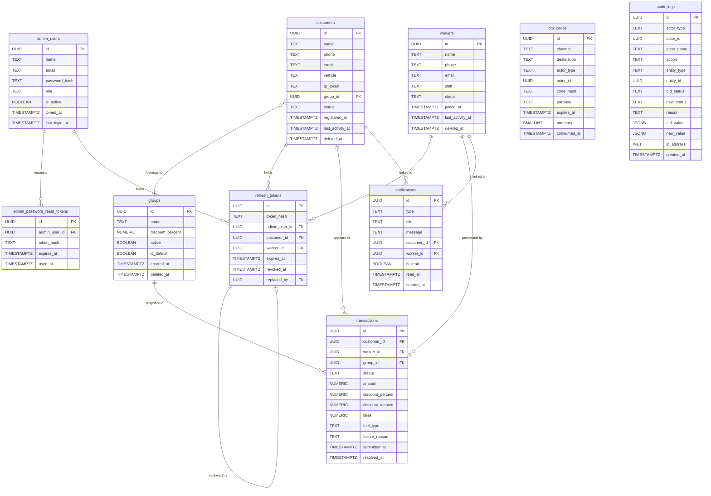

# FuelPoint — Database Schema Proposal (v3)

> **Status:** Draft for owner review — no SQL, no migration files, no code changes.
> **Scope:** Admin panel + worker mobile API + customer mobile API. One fuel station.
> **Date:** 2026-10-12
> **Supersedes:** `docs/db-schema-proposal-v2.md`

---

## 0. Decision Log

D01–D33 are carried forward from v2. Decisions that changed in v3 are marked **CHANGED in v3**. New decisions start at D34.

| # | Decision | Status | Source |
|---|---|---|---|
| D01 | One fuel station only — no `stations` table | DECIDED | Owner |
| D02 | Backend serves three clients: admin web panel, worker app, customer app. Mobile app screens are outside this project's scope; their APIs are in scope. | DECIDED | Owner |
| D03 | Separate tables per role: `admin_users`, `customers`, `workers`. Same phone or email may exist in both customers and workers — no cross-table uniqueness. | DECIDED | Owner |
| D04 | Customers and workers authenticate by OTP only — no `password_hash` on those tables. | DECIDED | Owner |
| D05 | OTP is delivered by SMS now; design for both SMS and email channels. | DECIDED | Owner |
| D06 | Only the admin has a password, a forgot-password flow, and a change-password screen. | DECIDED | Owner |
| D07 | Auth tokens: short-lived access token (not stored) + stored refresh token hashed in a single `refresh_tokens` table. Logout and "log out of all devices" must work. | DECIDED | Owner |
| D08 | Admin role is a display label only. No roles table, no permissions table. Only one admin exists but design must not block more. | DECIDED | Owner |
| D09 | Customer status: `active` / `inactive` only — no `pending`. Set manually by admin. | DECIDED | Owner |
| D10 | New customer is `active` immediately, placed in default group (0 % discount). | DECIDED | Owner |
| D11 | Inactive customer's scan is rejected; reason recorded in `audit_logs`. | DECIDED | Owner |
| D12 | Customers: soft delete, keep all data. | DECIDED | Owner |
| D13 | Customer vehicle: one optional free-text field. | DECIDED | Owner |
| D14 | Customer QR: encodes a separate random token stored on the customer row — not the DB id. Only the customer can regenerate it; old token stops working immediately. No admin regenerate button. | DECIDED | Owner |
| D15 | Worker status: `active` / `offline` / `suspended` — always set by admin. Suspended worker cannot log in or submit transactions. | DECIDED | Owner |
| D16 | Workers: soft delete, keep all data. | DECIDED | Owner |
| D17 | Transaction flow: worker scans QR → prefilled form (customer name, group) → worker enters amount → worker marks success or failed. | DECIDED | Owner |
| D18 | `amount` is price BEFORE discount. Customer pays `amount − discount_amount`. System calculates discount from customer's group. No fuel price table. | DECIDED | Owner |
| D19 | Transaction status: `pending` → `success` or `failed`. Worker (or admin — see D37) can change result later. Never auto-fails. | DECIDED | Owner |
| D20 | Failed transaction: new QR scan creates a NEW transaction; old one stays `failed`. | DECIDED | Owner |
| D21 | `litres` and `fuel_type` are optional — stored only if the worker fills them. | DECIDED | Owner |
| D22 | Optional failure reason (free text). Applies when status = `failed`. | DECIDED | Owner |
| D23 | Revenue, discount and customer-spend totals count `success` transactions only. | DECIDED | Owner |
| D24 | Worker "scans" = all submitted transactions (any status). Worker "transactions" = successful ones. Rejected scans (before a transaction is created) are NOT counted in either metric. | DECIDED | Owner |
| D25 | Rejected scan creates no transaction row; logged in `audit_logs` with reason. Admin panel must be able to show these. | DECIDED | Owner |
| D26 | Notifications: simple `is_read` flag per row (single admin). No per-admin read table for now. | DECIDED | Owner |
| D27 | No fuel price table, no vehicles table. | DECIDED | Owner |
| D28 | ID type: `UUID` via `gen_random_uuid()` (PG ≥ 13) or via the `pgcrypto` extension's `gen_random_uuid()` (PG < 13). **CHANGED in v3** — see §7.1 for corrected extension note. | PROPOSED | v1 analysis |
| D29 | All timestamps: `TIMESTAMPTZ`. | PROPOSED | v1 analysis |
| D30 | Money: `NUMERIC(12,2)`. Discount percent: `NUMERIC(5,2)`. Litres: `NUMERIC(8,2)`. | PROPOSED | v1 analysis |
| D31 | Discount rounding: `ROUND(amount × discount_percent / 100, 2)` — two decimal places. | DECIDED | Owner (v3) |
| D32 | Status / enum columns: PostgreSQL `ENUM` types. | PROPOSED | v1 analysis |
| D33 | Groups: soft delete (`deleted_at`). | DECIDED | Owner (v3) |
| D34 | Customer registration collects only `name` and `phone`. Customers self-register via OTP. `email` and `vehicle` remain optional columns, collected later. | DECIDED | Owner (v3) |
| D35 | A customer may have multiple concurrent `pending` transactions. A new scan always creates a new transaction. | DECIDED | Owner (v3) |
| D36 | Notifications are created for: new customer registration and new worker registration. `notifications` adds an optional `worker_id` FK (ON DELETE SET NULL) — PROPOSED. | DECIDED / PROPOSED | Owner (v3) |
| D37 | The admin may change a transaction's status. The status change is logged in `audit_logs` with `actor_type = 'admin'`. | DECIDED | Owner (v3) |
| D38 | Members of an inactive group receive 0 % discount (the scan is NOT rejected). The group's configured discount is ignored while it is inactive. | DECIDED | Owner (v3) |
| D39 | Workers are created by the admin only. Workers then use OTP login. No self-registration for workers. | DECIDED | Owner (v3) |
| D40 | `customer.last_activity_at` = timestamp of the latest `success` transaction for that customer. | DECIDED | Owner (v3) |
| D41 | `worker.last_activity_at` = timestamp of the latest submitted transaction (any status) for that worker. | DECIDED | Owner (v3) |
| D42 | Default group cannot be deactivated or deleted. Application layer enforces both. | DECIDED | Owner (v3) |
| D43 | `admin_users` gains an `is_active BOOLEAN NOT NULL DEFAULT TRUE`. A deactivated admin cannot log in and all their refresh tokens are revoked immediately. | DECIDED | Owner (v3) |
| D44 | Phone numbers stored in E.164 format (e.g. `+919820441120`). Emails stored lower-cased (or `citext`). Applied to `customers.phone`, `workers.phone`, `admin_users.phone`, and `otp_codes.destination`. | PROPOSED | Fix 4 |
| D45 | `otp_codes` is keyed by channel + destination, NOT by `actor_id`. A pre-registration OTP has no `actor_id`. | DECIDED | Fix 1 |
| D46 | Password-reset token expiry: 60 minutes. | DECIDED | Owner (v3) |
| D47 | OTP parameters: 6 digits, 5-minute expiry, 5 max failed attempts per code, 60-second resend cooldown, max 5 OTPs per hour per destination. | DECIDED | Owner (v3) |
| D48 | Refresh-token expiry: 7 days for admin, 30 days for customers and workers. | DECIDED | Owner (v3) |
| D49 | "Today" and daily time-bucket boundaries in the dashboard and reports use Asia/Kolkata time (IST, UTC+5:30), not UTC. | DECIDED | Fix 11 |

---

## 1. Table Overview (10 tables)

| Table | Purpose | Key decisions |
|---|---|---|
| `admin_users` | Admin login, profile, password, `is_active` flag | D06, D08, D43 |
| `admin_password_reset_tokens` | Forgot-password email tokens (admin only) | D06, D46 |
| `groups` | Discount groups; every customer belongs to one | D10, D33, D38, D42 |
| `customers` | Registered customers; OTP auth; QR token | D03, D04, D09–D14, D34 |
| `workers` | Pump attendants; OTP auth; admin-created | D03, D04, D15, D16, D39 |
| `otp_codes` | Hashed OTPs keyed by destination; supports pre-registration | D04, D05, D45, D47 |
| `refresh_tokens` | Hashed refresh tokens for all three actor types | D07, D43, D48 |
| `transactions` | Fuel scan events with `pending`/`success`/`failed` lifecycle | D17–D24, D35, D37 |
| `notifications` | Admin inbox; created for customer and worker registration | D26, D36 |
| `audit_logs` | Immutable record of all state changes and rejected scans | D25, D37 |

---

## 2. Tables

> **Conventions (see §5 for full discussion):**
> - Primary keys: `UUID` via `gen_random_uuid()` — PROPOSED D28
> - All timestamps: `TIMESTAMPTZ` — PROPOSED D29
> - Money: `NUMERIC(12,2)`; percent: `NUMERIC(5,2)`; litres: `NUMERIC(8,2)` — PROPOSED D30
> - Enums: PostgreSQL `ENUM` types — PROPOSED D32
> - `updated_at` on mutable tables is maintained by a database trigger, not by the application layer

---

### 2.1 `admin_users`

**Purpose:** Admin panel login credentials and profile. Designed to hold more than one admin without schema changes. Deactivated admins (`is_active = FALSE`) cannot log in and all their refresh tokens must be revoked by the backend when `is_active` is set to `FALSE`.

**Justification:** D06, D08, D43. `AdminProfile` interface in `types.ts`; login page `routes/index.tsx`; profile page `routes/_admin.profile.tsx`.

| Column | Type | Nullable | Default | Notes |
|---|---|---|---|---|
| `id` | `UUID` | NO | `gen_random_uuid()` | PK |
| `name` | `TEXT` | NO | — | Full name |
| `email` | `TEXT` | NO | — | Login credential. Lower-cased. UNIQUE. D44. |
| `phone` | `TEXT` | YES | NULL | E.164 format. UNIQUE when not NULL. D44. |
| `password_hash` | `TEXT` | NO | — | Argon2id or bcrypt. Never store plaintext. |
| `role` | `TEXT` | NO | `'Super Admin'` | Display label only. D08. |
| `location` | `TEXT` | YES | NULL | `AdminProfile.location` |
| `initials` | `VARCHAR(3)` | NO | — | Derived from name on save; stored for avatar display |
| `avatar_url` | `TEXT` | YES | NULL | Future upload placeholder |
| `is_active` | `BOOLEAN` | NO | `TRUE` | D43. `FALSE` = cannot log in; all refresh tokens revoked at time of deactivation. |
| `joined_at` | `TIMESTAMPTZ` | NO | `now()` | `AdminProfile.joinedAt` |
| `last_login_at` | `TIMESTAMPTZ` | YES | NULL | Updated on each successful login |
| `created_at` | `TIMESTAMPTZ` | NO | `now()` | |
| `updated_at` | `TIMESTAMPTZ` | NO | `now()` | Trigger-maintained |

**Primary key:** `(id)`

**Unique constraints:**
- `UNIQUE (email)` — email is lower-cased before storage
- `UNIQUE (phone) WHERE phone IS NOT NULL`

**Indexes:**
- `idx_admin_users_email` on `(email)` — login lookup

**Token revocation rule (D43):** The backend must revoke all active `refresh_tokens` where `admin_user_id = <id>` when `is_active` is set to `FALSE`. It must also re-check `is_active` on every authenticated request, not just at token issue time.

**No `deleted_at`:** An admin account is disabled via `is_active = FALSE`, not soft-deleted. This avoids ambiguity between "this admin no longer works here" and "this admin was deleted" — both are just `is_active = FALSE`. Rows are never hard-deleted (preserves `audit_logs` actor context).

---

### 2.2 `admin_password_reset_tokens`

**Purpose:** Time-limited, single-use tokens emailed to the admin for password reset. Pre-authentication; separate from `refresh_tokens`.

**Justification:** D06, D46.

| Column | Type | Nullable | Default | Notes |
|---|---|---|---|---|
| `id` | `UUID` | NO | `gen_random_uuid()` | PK |
| `admin_user_id` | `UUID` | NO | — | FK → `admin_users(id)` ON DELETE CASCADE |
| `token_hash` | `TEXT` | NO | — | SHA-256 of the emailed token. Never store plaintext. |
| `expires_at` | `TIMESTAMPTZ` | NO | — | `now() + interval '60 minutes'`. DECIDED D46. |
| `used_at` | `TIMESTAMPTZ` | YES | NULL | Set when token is consumed; NULL = not yet used |
| `created_at` | `TIMESTAMPTZ` | NO | `now()` | |

**Primary key:** `(id)`

**Foreign keys:**
- `admin_user_id → admin_users(id) ON DELETE CASCADE`

**Indexes:**
- `idx_admin_pw_reset_user` on `(admin_user_id, expires_at DESC)` — look up unused tokens per user
- `idx_admin_pw_reset_token` on `(token_hash)` — verification lookup

**Notes:**
- The application invalidates (marks `used_at = now()`) any prior unused token for the same admin before issuing a new one — one active reset at a time. PROPOSED.
- Expired and used tokens are hard-deleted by a cleanup job.

---

### 2.3 `groups`

**Purpose:** Discount groups. Every customer belongs to exactly one group. New customers land in the default group (0 % discount) until the admin reassigns them. Members of an inactive group receive **0 % discount** — the scan is not rejected (D38).

**Justification:** D10, D33, D38, D42. `Group` interface in `types.ts`; `routes/_admin.groups.tsx`.

| Column | Type | Nullable | Default | Notes |
|---|---|---|---|---|
| `id` | `UUID` | NO | `gen_random_uuid()` | PK |
| `name` | `TEXT` | NO | — | Unique among non-deleted groups |
| `discount_percent` | `NUMERIC(5,2)` | NO | `0.00` | CHECK 0–100. Applied only when group is active (D38). |
| `description` | `TEXT` | YES | NULL | |
| `active` | `BOOLEAN` | NO | `TRUE` | When `FALSE`, members transact at 0 % discount. Default group cannot be set to `FALSE` (D42). |
| `is_default` | `BOOLEAN` | NO | `FALSE` | Exactly one non-deleted row must be TRUE |
| `created_at` | `TIMESTAMPTZ` | NO | `now()` | |
| `updated_at` | `TIMESTAMPTZ` | NO | `now()` | Trigger-maintained |
| `deleted_at` | `TIMESTAMPTZ` | YES | NULL | Soft delete. D33. |

**Primary key:** `(id)`

**Unique constraints:**
- `UNIQUE (name) WHERE deleted_at IS NULL`
- `UNIQUE (is_default) WHERE is_default = TRUE AND deleted_at IS NULL` — enforces exactly one live default group

**Check constraints:**
- `CHECK (discount_percent BETWEEN 0 AND 100)`

**Indexes:**
- `idx_groups_active` on `(active) WHERE deleted_at IS NULL`

**Default group rules (D42):**
- Cannot be deleted — application layer blocks deletion when `is_default = TRUE`.
- Cannot be deactivated — application layer blocks setting `active = FALSE` when `is_default = TRUE`.
- Application resolves the default group UUID at startup: `SELECT id FROM groups WHERE is_default = TRUE AND deleted_at IS NULL`.

**Delete behaviour:** Before soft-deleting a group, the application moves all its members to the default group. The `deleted_at` column allows the group name to be reused later.

**Inactive group discount (D38):** When the worker app resolves a scan, the effective discount percent is:
```
effective_percent = CASE WHEN group.active THEN group.discount_percent ELSE 0 END
```
This value is what goes into `transactions.discount_percent` (snapshot). The scan is not rejected.

---

### 2.4 `customers`

**Purpose:** Registered customers. Self-register via OTP (name + phone only — D34). Login via OTP. Admin can create, edit, deactivate, and soft-delete.

**Justification:** D03, D04, D09–D14, D34, D35. `Customer` interface in `types.ts`; `routes/_admin.customers.tsx`.

| Column | Type | Nullable | Default | Notes |
|---|---|---|---|---|
| `id` | `UUID` | NO | `gen_random_uuid()` | PK |
| `name` | `TEXT` | NO | — | Collected at registration |
| `phone` | `TEXT` | NO | — | E.164 format. Primary OTP channel. UNIQUE (non-deleted). D44. |
| `email` | `TEXT` | YES | NULL | Optional. Lower-cased. UNIQUE when not NULL (non-deleted). D44. |
| `vehicle` | `TEXT` | YES | NULL | Free-text. Optional. D13. |
| `qr_token` | `TEXT` | NO | — | Random opaque token encoded in the QR code. Global UNIQUE. NOT the `id`. D14. |
| `group_id` | `UUID` | NO | — | FK → `groups(id)` ON DELETE RESTRICT. Default group at registration. D10. |
| `status` | `customer_status` | NO | `'active'` | `active` / `inactive`. Set manually by admin. D09, D10. |
| `registered_at` | `TIMESTAMPTZ` | NO | `now()` | |
| `last_activity_at` | `TIMESTAMPTZ` | YES | NULL | Timestamp of latest `success` transaction. Stored. D40. |
| `created_at` | `TIMESTAMPTZ` | NO | `now()` | |
| `updated_at` | `TIMESTAMPTZ` | NO | `now()` | Trigger-maintained |
| `deleted_at` | `TIMESTAMPTZ` | YES | NULL | Soft delete. D12. |

**Enum:**
```
customer_status: 'active', 'inactive'
```

**Primary key:** `(id)`

**Unique constraints:**
- `UNIQUE (phone) WHERE deleted_at IS NULL` — phone is stored in E.164 (D44)
- `UNIQUE (email) WHERE email IS NOT NULL AND deleted_at IS NULL` — email lower-cased (D44)
- `UNIQUE (qr_token)` — global, unfiltered; a superseded token must not match even a deleted customer

**Foreign keys:**
- `group_id → groups(id) ON DELETE RESTRICT`

**Indexes:**
- `idx_customers_phone` on `(phone) WHERE deleted_at IS NULL` — OTP lookup, search
- `idx_customers_email` on `(email) WHERE email IS NOT NULL AND deleted_at IS NULL`
- `idx_customers_qr_token` on `(qr_token)` — worker app QR scan lookup (must be very fast)
- `idx_customers_group_status` on `(group_id, status) WHERE deleted_at IS NULL` — filter panel
- `idx_customers_registered_at` on `(registered_at DESC) WHERE deleted_at IS NULL` — registrations report
- `idx_customers_last_activity` on `(last_activity_at DESC) WHERE deleted_at IS NULL` — activity sort

**QR token notes (D14):**
- Backend generates a random URL-safe token at creation time.
- Worker app resolves customer by `qr_token`, not by `id`.
- When the customer regenerates their QR, the backend atomically writes a new random value to `qr_token`. Any scan of the old token immediately returns `CUSTOMER_NOT_FOUND` (there is no "superseded" state — the old token simply no longer exists in any row).
- The scanned token value must **never** be written to `audit_logs` (rejected scans log the reason code, not the token value).
- No admin regenerate button.

**Token revocation on soft delete:** Soft-deleting a customer does NOT cascade-delete their `refresh_tokens` rows (ON DELETE CASCADE is intentionally absent here — see §2.7). The backend must explicitly revoke all active refresh tokens for the customer when soft-deleting.

---

### 2.5 `workers`

**Purpose:** Pump attendants. Created by the admin only (D39). OTP login. Status always set by admin.

**Justification:** D03, D04, D15, D16, D39. `Worker` interface in `types.ts`; `routes/_admin.workers.tsx`.

| Column | Type | Nullable | Default | Notes |
|---|---|---|---|---|
| `id` | `UUID` | NO | `gen_random_uuid()` | PK |
| `name` | `TEXT` | NO | — | Full name |
| `email` | `TEXT` | NO | — | Contact; future email OTP channel. Lower-cased. UNIQUE (non-deleted). D44. |
| `phone` | `TEXT` | NO | — | Primary OTP channel. E.164 format. UNIQUE (non-deleted). D44. |
| `shift` | `worker_shift` | NO | — | `Morning` / `Evening` / `Night` |
| `status` | `worker_status` | NO | `'active'` | `active` / `offline` / `suspended`. Set by admin. D15. |
| `joined_at` | `TIMESTAMPTZ` | NO | `now()` | |
| `last_activity_at` | `TIMESTAMPTZ` | YES | NULL | Timestamp of latest submitted transaction (any status). Stored. D41. |
| `created_at` | `TIMESTAMPTZ` | NO | `now()` | |
| `updated_at` | `TIMESTAMPTZ` | NO | `now()` | Trigger-maintained |
| `deleted_at` | `TIMESTAMPTZ` | YES | NULL | Soft delete. D16. |

**Enums:**
```
worker_shift:  'Morning', 'Evening', 'Night'
worker_status: 'active', 'offline', 'suspended'
```

**Primary key:** `(id)`

**Unique constraints:**
- `UNIQUE (email) WHERE deleted_at IS NULL`
- `UNIQUE (phone) WHERE deleted_at IS NULL`

**Indexes:**
- `idx_workers_phone` on `(phone) WHERE deleted_at IS NULL` — OTP lookup
- `idx_workers_email` on `(email) WHERE deleted_at IS NULL` — future email OTP
- `idx_workers_status_shift` on `(status, shift) WHERE deleted_at IS NULL` — filter panel

**Token revocation on suspension and soft delete:** Soft-delete and suspension do NOT trigger ON DELETE CASCADE on `refresh_tokens`. The backend must explicitly revoke all active refresh tokens for the worker when the worker is soft-deleted or their status is set to `suspended`. The backend must also re-check `status` on every authenticated request.

---

### 2.6 `otp_codes`

**Purpose:** Hashed one-time passcodes for customer and worker login, and for customer self-registration (where no `actor_id` exists yet). Keyed by destination (phone or email), not by actor identity. This design means an OTP request for an unknown phone does not reveal whether that phone is registered.

**Justification:** D04, D05, D34, D45, D47.

| Column | Type | Nullable | Default | Notes |
|---|---|---|---|---|
| `id` | `UUID` | NO | `gen_random_uuid()` | PK |
| `channel` | `otp_channel` | NO | — | `sms` / `email` |
| `destination` | `TEXT` | NO | — | E.164 phone or lower-cased email — the address the OTP was sent to. D44. |
| `actor_type` | `otp_actor_type` | YES | NULL | `customer` / `worker`. NULL when customer does not exist yet (registration). |
| `actor_id` | `UUID` | YES | NULL | ID in `customers` or `workers`. NULL for pre-registration OTPs. No DB FK. |
| `code_hash` | `TEXT` | NO | — | Hash of the 6-digit code (e.g. SHA-256). Never store plaintext. |
| `purpose` | `otp_purpose` | NO | — | `login` / `register` |
| `expires_at` | `TIMESTAMPTZ` | NO | — | `now() + interval '5 minutes'`. DECIDED D47. |
| `attempts` | `SMALLINT` | NO | `0` | Failed verification attempts |
| `consumed_at` | `TIMESTAMPTZ` | YES | NULL | Set on successful use; NULL = not yet consumed |
| `created_at` | `TIMESTAMPTZ` | NO | `now()` | |

**Enums:**
```
otp_channel:    'sms', 'email'
otp_actor_type: 'customer', 'worker'
otp_purpose:    'login', 'register'
```

**Primary key:** `(id)`

**No database FK on `actor_id`** — `actor_id` is NULL for pre-registration OTPs; referential integrity is enforced at the application layer after the customer row is created.

**Check constraints:**
- `CHECK (attempts >= 0)`
- `CHECK ((actor_type IS NULL) = (actor_id IS NULL))` — either both are set or both are NULL

**Indexes:**
- `idx_otp_destination_created` on `(channel, destination, created_at DESC)` — look up the latest OTP for a destination (rate limiting, resend cooldown)
- `idx_otp_expires` on `(expires_at) WHERE consumed_at IS NULL` — cleanup job

**Rate limiting (DECIDED D47):**

| Parameter | Value |
|---|---|
| Code length | 6 digits |
| Expiry window | 5 minutes |
| Max failed attempts per code | 5 — after 5 wrong attempts the code is invalidated; user must request a new one |
| Resend cooldown | 60 seconds — enforced at application layer |
| Max OTPs per hour per destination | 5 — enforced at application layer |

**Registration flow (D34, D45):**
1. Unknown phone requests a `register` OTP → row created with `actor_type = NULL`, `actor_id = NULL`.
2. Customer submits `name`, `phone`, and the 6-digit code → backend verifies, creates the customer row, sets `actor_id` = new customer UUID, marks `consumed_at`.
3. Backend issues access + refresh tokens for the new customer.

**Login flow for existing customer/worker:**
1. App sends phone + channel → OTP row created with `actor_type` and `actor_id` set (if the phone is found in the relevant table; if not found, a row is still created with NULL actor fields — the user sees the same "code sent" response either way, preventing phone enumeration).
2. App submits code → backend verifies, issues tokens.

**Security notes:**
- Store only the hash; the plaintext OTP is sent by SMS/email and never stored or logged.
- Consumed and expired OTPs are hard-deleted by a cleanup job.
- `otp.sent` audit action is removed (D45 — the `otp_codes` row itself records the event).

**Consistency with `refresh_tokens`:** `refresh_tokens` uses three nullable FK columns (§2.7) because tokens are long-lived and DB-level integrity matters. `otp_codes` uses a nullable `actor_id` without a FK because OTPs must pre-exist before the customer row does. The two designs are intentionally different.

---

### 2.7 `refresh_tokens`

**Purpose:** Hashed refresh tokens for all three actor types. Enables single-device logout and "log out of all devices". Access tokens are short-lived JWTs and are NOT stored.

**Justification:** D07, D43, D48.

| Column | Type | Nullable | Default | Notes |
|---|---|---|---|---|
| `id` | `UUID` | NO | `gen_random_uuid()` | PK |
| `token_hash` | `TEXT` | NO | — | SHA-256 of the refresh token. UNIQUE. Never store plaintext. |
| `admin_user_id` | `UUID` | YES | NULL | FK → `admin_users(id)` ON DELETE CASCADE |
| `customer_id` | `UUID` | YES | NULL | FK → `customers(id)` ON DELETE RESTRICT (**not** CASCADE — see note) |
| `worker_id` | `UUID` | YES | NULL | FK → `workers(id)` ON DELETE RESTRICT (**not** CASCADE — see note) |
| `expires_at` | `TIMESTAMPTZ` | NO | — | 7 days (admin), 30 days (customer/worker). DECIDED D48. |
| `issued_at` | `TIMESTAMPTZ` | NO | `now()` | |
| `last_used_at` | `TIMESTAMPTZ` | YES | NULL | Updated on each use |
| `revoked_at` | `TIMESTAMPTZ` | YES | NULL | Set on logout or explicit revocation; NULL = active |
| `replaced_by` | `UUID` | YES | NULL | FK → `refresh_tokens(id)` ON DELETE SET NULL — rotation chain |
| `user_agent` | `TEXT` | YES | NULL | |
| `ip_address` | `INET` | YES | NULL | |
| `created_at` | `TIMESTAMPTZ` | NO | `now()` | |

**Primary key:** `(id)`

**Unique constraints:**
- `UNIQUE (token_hash)`

**Check constraints:**
- `CHECK (num_nonnulls(admin_user_id, customer_id, worker_id) = 1)` — exactly one actor FK must be set. PROPOSED.

**Foreign keys:**
- `admin_user_id → admin_users(id) ON DELETE CASCADE` — admin rows are never hard-deleted, so this cascade never fires in practice
- `customer_id → customers(id) ON DELETE RESTRICT` — **not CASCADE**; see note below
- `worker_id → workers(id) ON DELETE RESTRICT` — **not CASCADE**; see note below
- `replaced_by → refresh_tokens(id) ON DELETE SET NULL`

**Why ON DELETE RESTRICT for customers and workers:**
Customers and workers are soft-deleted, not hard-deleted. `ON DELETE CASCADE` would never fire for a soft delete; it would fire only if a row were hard-deleted (which should not happen). Using `RESTRICT` makes an accidental hard delete fail loudly rather than silently cascade-delete audit-relevant token rows. The backend must explicitly revoke tokens (set `revoked_at = now()`) when soft-deleting a customer or worker, when suspending a worker, or when deactivating an admin.

**Backend responsibility checklist:**
- Customer soft-deleted → revoke all `customer_id = <id>` tokens.
- Worker soft-deleted → revoke all `worker_id = <id>` tokens.
- Worker suspended → revoke all `worker_id = <id>` tokens.
- Admin `is_active` set to `FALSE` → revoke all `admin_user_id = <id>` tokens.
- Every authenticated request must re-check the actor's status (active/inactive/suspended) after token verification.

**Rotation:**
- On each use, the current token is revoked (`revoked_at = now()`) and a new token is issued. `replaced_by` links old → new.
- If a revoked token is presented again, all tokens in the rotation chain are revoked ("token reuse detection").

**Logout:** `revoked_at = now()` on the presented token.
**Log out of all devices:** `revoked_at = now()` on all non-revoked tokens for the actor.

---

### 2.8 `transactions`

**Purpose:** Each fuelling event. Created as `pending` when a worker submits a scan; transitioned to `success` or `failed` by the worker or by the admin (D37). Multiple pending transactions per customer are allowed (D35).

**Justification:** D17–D24, D35, D37. `Transaction` interface in `types.ts`; `routes/_admin.reports.tsx`; `routes/_admin.dashboard.tsx`; customer and worker detail dialogs.

| Column | Type | Nullable | Default | Notes |
|---|---|---|---|---|
| `id` | `UUID` | NO | `gen_random_uuid()` | PK |
| `customer_id` | `UUID` | NO | — | FK → `customers(id)` ON DELETE RESTRICT |
| `worker_id` | `UUID` | NO | — | FK → `workers(id)` ON DELETE RESTRICT |
| `group_id` | `UUID` | NO | — | FK → `groups(id)` ON DELETE RESTRICT — snapshot of customer's group at scan time |
| `status` | `transaction_status` | NO | `'pending'` | `pending` / `success` / `failed`. D19. |
| `amount` | `NUMERIC(12,2)` | NO | — | Price BEFORE discount. D18. Must be > 0. |
| `discount_percent` | `NUMERIC(5,2)` | NO | `0.00` | Snapshot: effective discount at scan time (0 if group was inactive). D18, D38. CHECK 0–100. |
| `discount_amount` | `NUMERIC(12,2)` | NO | `0.00` | `ROUND(amount × discount_percent / 100, 2)`. Stored for auditability. D31. CHECK ≥ 0 AND ≤ `amount`. |
| `litres` | `NUMERIC(8,2)` | YES | NULL | Optional. D21. CHECK > 0 when not NULL. |
| `fuel_type` | `fuel_type` | YES | NULL | Optional. D21. |
| `failure_reason` | `TEXT` | YES | NULL | Optional. D22. See open question Q3. |
| `submitted_at` | `TIMESTAMPTZ` | NO | `now()` | When the worker submitted the scan. This is the single creation timestamp; `created_at` is dropped (fix 9). |
| `resolved_at` | `TIMESTAMPTZ` | YES | NULL | When status first left `pending`. Updated on each status change. |
| `updated_at` | `TIMESTAMPTZ` | NO | `now()` | Trigger-maintained |

**Enum:**
```
transaction_status: 'pending', 'success', 'failed'
fuel_type:          'Petrol', 'Diesel', 'CNG'
```

**Primary key:** `(id)`

**Foreign keys:**
- `customer_id → customers(id) ON DELETE RESTRICT`
- `worker_id → workers(id) ON DELETE RESTRICT`
- `group_id → groups(id) ON DELETE RESTRICT`

**Check constraints:**
- `CHECK (amount > 0)` — must be positive (fix 9)
- `CHECK (discount_percent BETWEEN 0 AND 100)`
- `CHECK (discount_amount >= 0)`
- `CHECK (discount_amount <= amount)` — discount cannot exceed the charge (fix 9)
- `CHECK (litres > 0 OR litres IS NULL)`

**Indexes:**
- `idx_transactions_customer_submitted` on `(customer_id, submitted_at DESC)`
- `idx_transactions_worker_submitted` on `(worker_id, submitted_at DESC)`
- `idx_transactions_group_submitted` on `(group_id, submitted_at DESC)`
- `idx_transactions_status_submitted` on `(status, submitted_at DESC)`
- `idx_transactions_submitted_at` on `(submitted_at DESC)` — date-range filter

**Notes:**
- No `customerName` / `workerName` columns — the API JOINs on demand.
- `group_id` and `discount_percent` are snapshots; the group's discount can change after the transaction. The effective discount at scan time (0 % if the group was inactive) is what is stored (D38).
- Every status change produces an `audit_logs` row (§3.3). Status may be changed by the original worker or by the admin (D37).
- "Scans" (D24): `COUNT(*) WHERE worker_id = ?` (all statuses).
- "Transactions" (D24): `COUNT(*) WHERE worker_id = ? AND status = 'success'`.
- Revenue/discount totals (D23): `WHERE status = 'success'`.
- "Today" boundaries use Asia/Kolkata time (D49).

---

### 2.9 `notifications`

**Purpose:** Admin inbox. Created automatically on new customer registration and new worker registration (D36). Single `is_read` flag per row (D26).

**Justification:** D26, D36. `Notification` interface in `types.ts`; `routes/_admin.notifications.tsx`.

| Column | Type | Nullable | Default | Notes |
|---|---|---|---|---|
| `id` | `UUID` | NO | `gen_random_uuid()` | PK |
| `type` | `notification_type` | NO | — | `registration` / `group` / `worker` / `system` |
| `title` | `TEXT` | NO | — | Short heading |
| `message` | `TEXT` | NO | — | Full body text |
| `customer_id` | `UUID` | YES | NULL | FK → `customers(id)` ON DELETE SET NULL. Powers "Open customer" button. |
| `worker_id` | `UUID` | YES | NULL | FK → `workers(id)` ON DELETE SET NULL. Powers "Open worker" button. PROPOSED. D36. |
| `is_read` | `BOOLEAN` | NO | `FALSE` | D26. |
| `read_at` | `TIMESTAMPTZ` | YES | NULL | Set when `is_read` flips to TRUE |
| `created_at` | `TIMESTAMPTZ` | NO | `now()` | |

**Enum:**
```
notification_type: 'registration', 'group', 'worker', 'system'
```

**Primary key:** `(id)`

**Check constraints:**
- `CHECK (NOT (customer_id IS NOT NULL AND worker_id IS NOT NULL))` — a notification links to at most one entity. PROPOSED.

**Foreign keys:**
- `customer_id → customers(id) ON DELETE SET NULL`
- `worker_id → workers(id) ON DELETE SET NULL` — PROPOSED, D36

**Indexes:**
- `idx_notifications_is_read_created` on `(is_read, created_at DESC)` — unread count + sorted list
- `idx_notifications_type_created` on `(type, created_at DESC)` — filter by type
- `idx_notifications_customer` on `(customer_id) WHERE customer_id IS NOT NULL`
- `idx_notifications_worker` on `(worker_id) WHERE worker_id IS NOT NULL`

**Future multi-admin note:** If more admins are added, `is_read` / `read_at` must be replaced by a `notification_reads(notification_id, admin_user_id, read_at)` join table. The current flag data can be migrated (attributed to admin #1).

---

### 2.10 `audit_logs`

**Purpose:** Immutable, append-only record of every state-changing action and of rejected scans (D25). The admin panel filters by action, actor, entity, reason, and date.

**Justification:** D25, D37.

| Column | Type | Nullable | Default | Notes |
|---|---|---|---|---|
| `id` | `UUID` | NO | `gen_random_uuid()` | PK |
| `actor_type` | `TEXT` | NO | — | `'admin'` / `'worker'` / `'customer'` / `'system'` |
| `actor_id` | `UUID` | YES | NULL | ID in the relevant actor table. NULL for system. **No FK** — audit history must survive entity deletion. |
| `actor_name` | `TEXT` | YES | NULL | Snapshot of actor name at log time (readable after soft delete) |
| `action` | `TEXT` | NO | — | Action code — see §3.1 |
| `entity_type` | `TEXT` | YES | NULL | `'customer'` / `'worker'` / `'group'` / `'transaction'` / `'admin_user'` |
| `entity_id` | `UUID` | YES | NULL | PK of the affected row. **No FK.** |
| `old_status` | `TEXT` | YES | NULL | Previous status value for status-change actions |
| `new_status` | `TEXT` | YES | NULL | New status value for status-change actions |
| `reason` | `TEXT` | YES | NULL | Rejection reason code (for `scan.rejected`) or other contextual reason |
| `old_value` | `JSONB` | YES | NULL | Snapshot of relevant fields before change |
| `new_value` | `JSONB` | YES | NULL | Snapshot of relevant fields after change |
| `ip_address` | `INET` | YES | NULL | Client IP |
| `user_agent` | `TEXT` | YES | NULL | |
| `created_at` | `TIMESTAMPTZ` | NO | `now()` | Immutable — never updated |

**Primary key:** `(id)`

**No foreign keys on `actor_id` or `entity_id`.** Audit history must be readable after entity deletion.

**Indexes:**
- `idx_audit_action_created` on `(action, created_at DESC)`
- `idx_audit_actor_created` on `(actor_type, actor_id, created_at DESC)`
- `idx_audit_entity_created` on `(entity_type, entity_id, created_at DESC)`
- `idx_audit_created_at` on `(created_at DESC)`
- `idx_audit_reason` on `(reason, created_at DESC) WHERE reason IS NOT NULL`

**Immutability:** No `UPDATE` or `DELETE`. Enforce via a PostgreSQL role with `INSERT`-only privilege, or a `BEFORE UPDATE OR DELETE` trigger that raises an exception.

**Snapshot security rule:** `old_value` and `new_value` JSONB must **never** contain:
- `password_hash` or any password field
- `code_hash` or the plaintext OTP code
- `token_hash` or any raw token value
- `qr_token` or any scanned QR token value
- Any field ending in `_hash` or `_token`

Enforced at the application layer.

---

## 3. `audit_logs` — Actions and Rejected Scan Reasons

### 3.1 Action codes

All action codes follow the pattern `entity.verb`.

**Admin actions (`actor_type = 'admin'`):**

| Action code | Description | `old/new_status` | Notable `old/new_value` fields |
|---|---|---|---|
| `admin.login` | Successful login | — | — |
| `admin.login_failed` | Failed login attempt | — | — |
| `admin.logout` | Admin logged out | — | — |
| `admin.password_changed` | Own password changed | — | — (never log the hash) |
| `admin.profile_updated` | Profile fields updated | — | Changed fields only (no hashes) |
| `admin.deactivated` | Admin account set to `is_active = FALSE` | — | — |
| `customer.created` | Admin created a customer | — | new_value: name, phone |
| `customer.updated` | Admin edited a customer | — | Changed fields |
| `customer.deleted` | Admin soft-deleted a customer | — | old_value: name, phone |
| `customer.status_changed` | Admin changed customer active/inactive | old → new | — |
| `customer.group_assigned` | Admin assigned customer to a group | — | `{old_group_id, new_group_id, group_name}` |
| `worker.created` | Admin created a worker | — | new_value: name, phone |
| `worker.updated` | Admin edited a worker | — | Changed fields |
| `worker.deleted` | Admin soft-deleted a worker | — | old_value: name, phone |
| `worker.status_changed` | Admin changed worker status (incl. suspend) | old → new | — |
| `group.created` | Admin created a group | — | new_value |
| `group.updated` | Admin updated a group | — | Changed fields |
| `group.toggled` | Admin toggled group active/inactive | — | `{active: old, new}` |
| `group.deleted` | Admin deleted a group | — | old_value: name |
| `transaction.status_changed` | **Admin** changed a transaction's status | old → new | `{resolved_at, failure_reason}` |

**Worker actions (`actor_type = 'worker'`):**

| Action code | Description | `old/new_status` | Notable fields |
|---|---|---|---|
| `transaction.created` | Worker submitted a scan (transaction created as `pending`) | — | `{customer_id, amount, discount_percent, discount_amount}` |
| `transaction.status_changed` | Worker marked transaction success or failed | old → new | `{resolved_at, failure_reason if any}` |
| `scan.rejected` | Scan rejected before a transaction was created | — | `reason` code (§3.2) |

**Customer actions (`actor_type = 'customer'`):**

| Action code | Description |
|---|---|
| `customer.qr_regenerated` | Customer regenerated their QR token. Old and new token values are **never** logged. |

**System actions (`actor_type = 'system'`, `actor_id = NULL`):**

| Action code | Description |
|---|---|
| `notification.created` | System created a notification |

> `notification.read` and `notification.all_read` are not logged — high-noise, low audit value.
> `otp.sent` is removed — the `otp_codes` row itself records the event (fix 10).

### 3.2 Rejected scan reason codes

Stored in `audit_logs.reason` for `scan.rejected` entries. The admin panel can filter on this column.

| Code | Description | Status |
|---|---|---|
| `CUSTOMER_NOT_FOUND` | No customer matches the scanned QR token (includes superseded / regenerated tokens — D14) | DECIDED |
| `CUSTOMER_INACTIVE` | Customer exists but `status = 'inactive'` (D11) | DECIDED |
| `WORKER_SUSPENDED` | The submitting worker is `suspended` (D15) | PROPOSED |

> **Removed in v3:** `QR_TOKEN_INVALID` — after a QR regeneration the old token simply does not exist, so it is indistinguishable from `CUSTOMER_NOT_FOUND` (fix 2).
> **Removed in v3:** `TRANSACTION_ALREADY_PENDING` — multiple concurrent pending transactions are allowed (D35).

### 3.3 Transaction status change logging rule

Every change to `transactions.status` (by a worker or by the admin) must write an `audit_logs` row:
- `action = 'transaction.status_changed'`
- `entity_type = 'transaction'`, `entity_id` = transaction UUID
- `actor_type` = `'worker'` or `'admin'` (D37)
- `actor_id` = the worker's or admin's UUID
- `old_status` / `new_status` = the transition
- `new_value` = `{ resolved_at, failure_reason }` (include `failure_reason` only when set)

This creates a full audit trail even if the status is changed multiple times (D19).

---

## 4. Computed Values

All totals filter `WHERE status = 'success'` (D23). `last_activity_at` semantics are now DECIDED (D40, D41).

| Aggregate | Decision | Formula |
|---|---|---|
| `customer.transactionCount` | **Compute** | `COUNT(*) WHERE customer_id = ? AND status = 'success'` |
| `customer.totalSpend` | **Compute** | `SUM(amount) WHERE customer_id = ? AND status = 'success'` |
| `customer.discountReceived` | **Compute** | `SUM(discount_amount) WHERE customer_id = ? AND status = 'success'` |
| `customer.last_activity_at` | **Store** — D40 | Updated when a `success` transaction is committed for this customer |
| `worker.scans` | **Compute** | `COUNT(*) WHERE worker_id = ?` (all statuses — D24) |
| `worker.transactionCount` | **Compute** | `COUNT(*) WHERE worker_id = ? AND status = 'success'` |
| `worker.customersScanned` | **Compute** | `COUNT(DISTINCT customer_id) WHERE worker_id = ?` (all statuses) |
| `worker.discountProcessed` | **Compute** | `SUM(discount_amount) WHERE worker_id = ? AND status = 'success'` |
| `worker.last_activity_at` | **Store** — D41 | Updated when any transaction is submitted (any status) |
| Group customer count | **Compute** | `COUNT(*) FROM customers WHERE group_id = ? AND deleted_at IS NULL` |
| Group transaction count | **Compute** | `COUNT(*) WHERE group_id = ? AND status = 'success'` |
| Group discount generated | **Compute** | `SUM(discount_amount) WHERE group_id = ? AND status = 'success'` |
| Dashboard "today" metrics | **Compute** | Filtered by date in Asia/Kolkata time (D49) |

**Escalation path:** At high transaction volumes, introduce a PostgreSQL materialised view or nightly rollup table — not denormalised columns on entity rows.

---

## 5. Cross-Cutting Decisions

### 5.1 ID type — PROPOSED D28

| Option | Pros | Cons |
|---|---|---|
| `UUID` | No sequential guessing; safe in URLs; mobile apps can generate offline | Larger (16 bytes vs 8); slightly slower B-tree on very large tables |
| `BIGINT` / `BIGSERIAL` | Smaller; faster range scans | Sequential — guessable; mobile apps need a server round-trip |

**Recommendation: UUID** — PROPOSED D28.

> **PostgreSQL notes (corrected in v3 — fix 6):**
> - `gen_random_uuid()` is built into PostgreSQL core from **version 13**.
> - On **PostgreSQL 12 and earlier**, `gen_random_uuid()` is provided by the **`pgcrypto`** extension (not `uuid-ossp`).
> - `uuid_generate_v4()` is provided by the **`uuid-ossp`** extension — a different extension entirely.
> - `ALTER TYPE … ADD VALUE` — safe inside a transaction from **PostgreSQL 12**.
> - `ALTER TYPE … RENAME VALUE` — available from **PostgreSQL 10**.

---

### 5.2 Timestamps — PROPOSED D29

`TIMESTAMPTZ` everywhere. Stores the absolute UTC moment; clients render in their local time zone.

`updated_at` is maintained by a trigger per table (not the application layer).

**India time for "today" (D49):** Dashboard and report date-bucket boundaries must be computed in `Asia/Kolkata` (IST, UTC+5:30, no DST). PostgreSQL `AT TIME ZONE 'Asia/Kolkata'` or equivalent application-layer conversion must be used. Storing timestamps in UTC (`TIMESTAMPTZ`) and converting at query time is the correct approach.

---

### 5.3 Money and numeric precision — PROPOSED D30, DECIDED D31

| Field | Type | Notes |
|---|---|---|
| `amount`, `discount_amount` | `NUMERIC(12,2)` | INR, two decimal places |
| `discount_percent` | `NUMERIC(5,2)` | 0.00–100.00 |
| `litres` | `NUMERIC(8,2)` | Two decimal places |

**Never use `FLOAT` or `DOUBLE PRECISION` for money.**

**Discount rounding (D31):** `ROUND(amount × discount_percent / 100, 2)` — two decimal places. DECIDED.

---

### 5.4 Status / enum fields — PROPOSED D32

| Option | Pros | Cons |
|---|---|---|
| PostgreSQL `ENUM` | Type-safe at DB level; compact; clear intent | Adding a value: `ALTER TYPE … ADD VALUE` (PG ≥ 12 in transaction); renaming: `ALTER TYPE … RENAME VALUE` (PG ≥ 10) |
| `TEXT` + `CHECK` | Easy to add/rename values | No DB-level type safety |
| Lookup table | Full referential integrity; easy to extend | Extra JOIN; overkill for 2–4 values |

**Recommendation: PostgreSQL `ENUM`** for all closed sets: `customer_status`, `worker_status`, `worker_shift`, `transaction_status`, `fuel_type`, `notification_type`, `otp_channel`, `otp_actor_type`, `otp_purpose`. — PROPOSED D32.

---

### 5.5 Soft delete

| Table | Decision | Justification |
|---|---|---|
| `customers` | Soft delete (`deleted_at`) | D12 |
| `workers` | Soft delete (`deleted_at`) | D16 |
| `groups` | Soft delete (`deleted_at`) | D33 |
| `transactions` | No delete | Financial record; immutable |
| `audit_logs` | No delete | Immutable by design |
| `notifications` | Hard delete acceptable | Low archival value |
| `otp_codes` | Hard delete by cleanup job | Consumed / expired codes have no value |
| `refresh_tokens` | Hard delete by cleanup job | Revoked / expired tokens have no value |
| `admin_password_reset_tokens` | Hard delete by cleanup job | Consumed / expired tokens have no value |
| `admin_users` | No `deleted_at`; disable via `is_active = FALSE` | D43 |

---

### 5.6 Phone and email normalisation — PROPOSED D44

All phone and email values must be normalised before storage and before index comparison.

**Phone (E.164):**
- Store as E.164 (e.g. `+919820441120`) — no spaces, no hyphens, leading `+`.
- The mock data stores phones with spaces (e.g. `+91 98204 41120`). The backend API layer must strip spaces and reformat to E.164 before writing.
- Applied to: `customers.phone`, `workers.phone`, `admin_users.phone`, `otp_codes.destination` (when channel = `sms`).

**Email (lower-case):**
- Store lower-cased. Two options:

| Option | Pros | Cons |
|---|---|---|
| Application lower-cases before write | Works on any PG version | Must also lower-case in every query; easy to forget |
| `citext` extension column | Case-insensitive comparison is automatic in all queries | Requires `CREATE EXTENSION citext`; slight overhead |

**Recommendation: lower-case in the application layer** before write and before query, store as `TEXT`. PROPOSED D44. Using `citext` is an equally valid alternative if the team prefers DB-level enforcement.

**Unique index implications:** The existing partial unique indexes on `phone` and `email` work correctly once values are normalised — no change to the index definitions is needed.

---

### 5.7 Default group behaviour — DECIDED D42

- Exactly one non-deleted group has `is_default = TRUE` — enforced by partial unique index.
- Cannot be deleted — application layer blocks deletion when `is_default = TRUE`.
- Cannot be deactivated — application layer blocks `active = FALSE` when `is_default = TRUE` (D42).
- Application resolves UUID at startup: `SELECT id FROM groups WHERE is_default = TRUE AND deleted_at IS NULL`.

---

## 6. ER Diagram



---

## 7. Frontend Changes This Implies

Documentation only — no code is changed here.

1. **Remove `'pending'` from `customer_status`** — `types.ts` `Customer.status` and all status dropdowns in `_admin.customers.tsx` (D09).
2. **Remove `password` fields for customers** — `Customer.password?` from `types.ts`; password inputs from the Create/Edit Customer dialog (D04).
3. **Remove `password` fields for workers** — `Worker.password?` from `types.ts`; password inputs from the Create/Edit Worker dialog (D04).
4. **Remove the rule that assigning a group makes a customer active** — `assignCustomerGroup` in `admin-store.tsx` currently sets `status: 'active'`; remove this (D09, D10).
5. **Admin can edit worker status directly** — confirm all three values (`active`, `offline`, `suspended`) are in the status dropdown (D15).
6. **Transaction status in lists and details** — add a `status` column (`pending` / `success` / `failed`) colour-coded in reports, customer detail, and worker detail views (D19).
7. **Optional fuel and litres shown safely when null** — guard against `litres = null` and `fuel_type = null`; show "—" instead of crashing (D21).
8. **Totals count `success` only** — update `buildOverview()` and all revenue/discount aggregations to filter by `status = 'success'` when the real API is wired (D23).
9. **Add an Audit Log view** — new admin route; filterable by action, actor, entity, reason, and date; includes rejected scan entries (D25). New file required.
10. **No QR regenerate button for admin** — do not add a "Regenerate QR" button to the customer detail dialog (D14).
11. **Worker scans vs transactions labels** — clarify: "Scans" = all submissions, "Transactions" = success only (D24).
12. **Failure reason in transaction detail** — show `failure_reason` when `status = 'failed'` and a reason is present (D22).
13. **Admin transaction status control** — the admin panel needs a control (e.g. a dropdown or action button) to change a transaction's status and optionally set or edit the `failure_reason`. This is a new capability in the transaction detail view (D37). See open question Q3 for whether admin can edit the reason independently.
14. **Phone input normalisation** — all phone number inputs (customer, worker, admin profile) must validate and normalise to E.164 format before sending to the API (D44). Display formatting (adding spaces for readability) may differ from the stored value.
15. **Inactive group — no discount, not rejected** — the frontend should display the effective discount (0 %) for a customer in an inactive group, not an error state (D38).

---

## 8. Proposed Wording for `backend/README.md`

> **Do not edit `backend/README.md` — documentation text only.**

```
## Scope

This backend serves three clients:

| Client                        | API built by  |
|-------------------------------|---------------|
| Admin web panel (../frontend) | This project  |
| Worker mobile app             | This project  |
| Customer mobile app           | This project  |

The mobile app screens are outside this project's development scope.
The API endpoints those apps call are within scope.

All three clients share one PostgreSQL database. One fuel station;
no multi-station architecture is planned.
```

---

## 9. Open Questions

1. **Inactive group scan — customer communication:** When a customer's group is inactive, they transact at 0 % discount (D38). Should the worker app or customer app display a message explaining why no discount was applied? This is an API design question (what metadata does the transaction response include), not a schema question.

2. **Worker creation flow security:** Workers are created by the admin only (D39). The admin sets the worker's name, phone, and shift. On first login, the worker receives an OTP to their phone. Is this the intended flow, or should there be an explicit "account setup" step (e.g. the worker sets a display name from their app)?

3. **Admin editing `failure_reason`:** When the admin changes a transaction's status, may they also set or edit `failure_reason`? If yes, the API must accept `failure_reason` as an optional parameter on the status-change endpoint and update the column; if no, `failure_reason` is write-once by the worker.

4. **Notification triggers — full list:** D36 decides notifications are created for new customer and new worker registration. Should any other events create notifications (e.g. worker suspended by admin, group discount changed)? The owner should enumerate the full list.

5. **`admin_users.phone` format:** Admin phone numbers should follow E.164 (D44). The current mock stores `phone: "..."` as a free-text string. Should the admin profile form validate and normalise the phone, or is it a free-text display field for the admin?

6. **Refresh token per-device management:** `refresh_tokens` records `user_agent` and `ip_address` at issuance. Should the admin panel (or the worker/customer apps) expose a "current sessions" list so a user can see and revoke individual devices? This does not require a schema change but needs an API endpoint.

7. **`otp_codes.actor_id` back-fill on registration:** After a customer self-registers successfully, the OTP row's `actor_id` is set to the new customer UUID. Should this back-fill happen (to maintain a consistent link between OTP and actor) or should the OTP row simply be marked `consumed_at` and the actor link left NULL? Both are acceptable — PROPOSED to back-fill.

---

*End of v3 proposal. Awaiting orchestrator instructions.*
