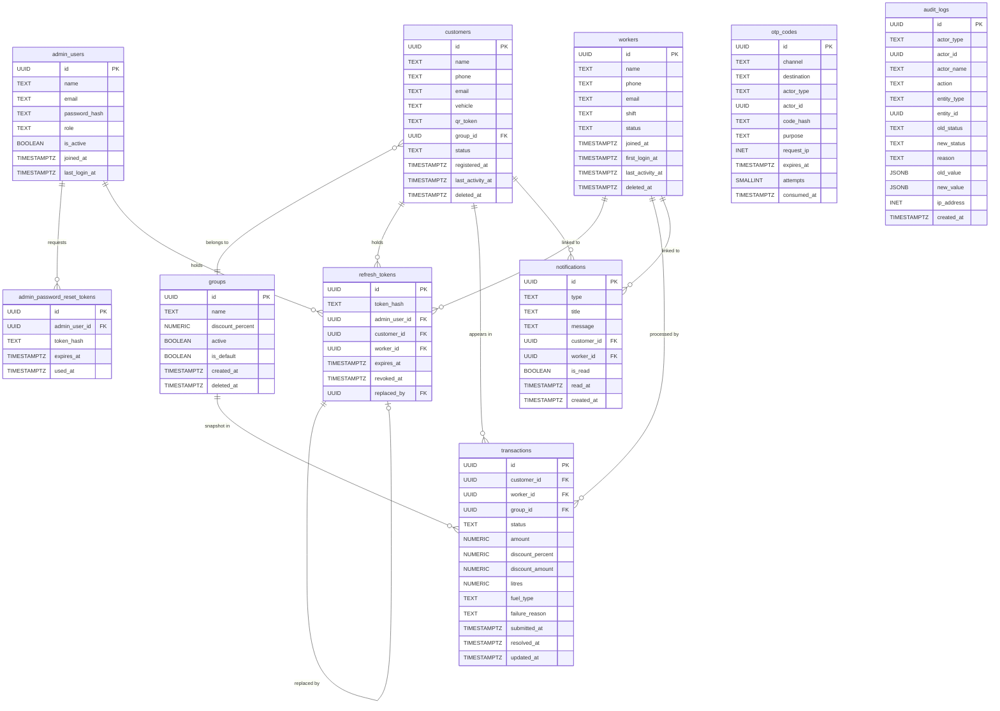

# FuelPoint — Database Schema Proposal (v5)

> **Status:** Final candidate v5: pending owner sign-off.
> **Scope:** Admin panel + worker mobile API + customer mobile API. One fuel station.
> **Date:** 2026-10-12
> **Supersedes:** `docs/db-schema-proposal-v4.md`

---

## 0. Decision Log

D01–D52 carried forward; decisions that changed in v5 are marked **CHANGED in v5**. New decisions start at D53.

| # | Decision | Status | Source |
|---|---|---|---|
| D01 | One fuel station only — no `stations` table | DECIDED | Owner |
| D02 | Backend serves three clients: admin web panel, worker app, customer app. Mobile app screens are outside this project's scope; their APIs are in scope. | DECIDED | Owner |
| D03 | Separate tables per role: `admin_users`, `customers`, `workers`. Same phone or email may exist in both tables — no cross-table uniqueness. | DECIDED | Owner |
| D04 | Customers and workers authenticate by OTP only — no `password_hash` on those tables. | DECIDED | Owner |
| D05 | OTP is delivered by SMS now; design for both SMS and email channels. | DECIDED | Owner |
| D06 | Only the admin has a password, a forgot-password flow, and a change-password screen. | DECIDED | Owner |
| D07 | Auth tokens: short-lived access token (not stored) + stored refresh token hashed in a single `refresh_tokens` table. Logout and "log out of all devices" must work. | DECIDED | Owner |
| D08 | Admin role is a display label only. No roles table, no permissions table. Only one admin exists but design must not block more. | DECIDED | Owner |
| D09 | Customer status: `active` / `inactive` only — no `pending`. Set manually by admin. | DECIDED | Owner |
| D10 | New customer is `active` immediately, placed in default group (0 % discount). | DECIDED | Owner |
| D11 | Inactive customer's scan is rejected; reason recorded in `audit_logs`. | DECIDED | Owner |
| D12 | Customers: soft delete, keep all data. | DECIDED | Owner |
| D13 | Customer vehicle: one optional free-text field. | DECIDED | Owner |
| D14 | Customer QR: encodes a separate random token stored on the customer row — not the DB id. Only the customer can regenerate it; old token stops working immediately. No admin regenerate button. | DECIDED | Owner |
| D15 | Worker status: `active` / `offline` / `suspended` — always set by admin. Suspended worker cannot log in or submit transactions. | DECIDED | Owner |
| D16 | Workers: soft delete, keep all data. | DECIDED | Owner |
| D17 | Transaction flow: worker scans QR → prefilled form (customer name, group) → worker enters amount → worker marks success or failed. | DECIDED | Owner |
| D18 | `amount` is price BEFORE discount. Customer pays `amount − discount_amount`. System calculates discount from customer's group. No fuel price table. | DECIDED | Owner |
| D19 | Transaction status lifecycle: `pending` → `success` or `failed`. Once resolved, `success` and `failed` may be changed to each other (by worker or admin) with no time limit. A transaction can NEVER return to `pending`. | DECIDED | Owner |
| D20 | Failed transaction: new QR scan creates a NEW transaction; the old one stays `failed`. | DECIDED | Owner |
| D21 | `litres` and `fuel_type` are optional — stored only if the worker fills them. | DECIDED | Owner |
| D22 | Optional failure reason (free text). Applies when `status = 'failed'`. | DECIDED | Owner |
| D23 | Revenue, discount and customer-spend totals count `success` transactions only. | DECIDED | Owner |
| D24 | Worker "scans" = all submitted transactions (any status). Worker "transactions" = successful ones. Rejected scans (before a transaction exists) are NOT counted in either metric. | DECIDED | Owner |
| D25 | Rejected scan creates no transaction row; logged in `audit_logs` with reason. Admin panel must be able to show these. | DECIDED | Owner |
| D26 | Notifications: simple `is_read` flag per row (single admin). No per-admin read table for now. | DECIDED | Owner |
| D27 | No fuel price table, no vehicles table. | DECIDED | Owner |
| D28 | ID type: `UUID` via `gen_random_uuid()` (PG ≥ 13) or via the `pgcrypto` extension's `gen_random_uuid()` (PG < 13). | DECIDED | Owner |
| D29 | All timestamps: `TIMESTAMPTZ`. | DECIDED | Owner |
| D30 | Money: `NUMERIC(12,2)`. Discount percent: `NUMERIC(5,2)`. Litres: `NUMERIC(8,2)`. | DECIDED | Owner |
| D31 | Discount rounding: `ROUND(amount × discount_percent / 100, 2)` — two decimal places. | DECIDED | Owner |
| D32 | Status / enum columns: PostgreSQL `ENUM` types. | DECIDED | Owner |
| D33 | Groups: soft delete (`deleted_at`). | DECIDED | Owner |
| D34 | Customer registration collects only `name` and `phone`. Customers self-register via OTP. `email` and `vehicle` remain optional columns, collected later. | DECIDED | Owner |
| D35 | A customer may have multiple concurrent `pending` transactions. A new scan always creates a new transaction. | DECIDED | Owner |
| D36 | Notifications are created for: (1) new customer registration, (2) a worker's first successful OTP login. `notifications.worker_id` FK (ON DELETE SET NULL) added. | DECIDED / PROPOSED | Owner |
| D37 | The admin may change a transaction's status. The status change is logged in `audit_logs` with `actor_type = 'admin'`. | DECIDED | Owner |
| D38 | Members of an inactive group receive 0 % discount (the scan is NOT rejected). | DECIDED | Owner |
| D39 | Workers are created by the admin only. Workers then use OTP login — no self-registration. | DECIDED | Owner |
| D40 | `customer.last_activity_at` = timestamp of the latest `success` transaction for that customer. Whenever any transaction's status transitions between `success` and `failed`, `customer.last_activity_at` is recalculated (latest remaining `success` transaction, or `NULL`). **CHANGED in v5.** | DECIDED / PROPOSED | Owner / Technical default |
| D41 | `worker.last_activity_at` = timestamp of the latest submitted transaction (any status) for that worker. Not affected by status transitions. | DECIDED | Owner |
| D42 | Default group cannot be deactivated or deleted. Application layer enforces both. | DECIDED | Owner |
| D43 | `admin_users` has an `is_active BOOLEAN NOT NULL DEFAULT TRUE`. A deactivated admin cannot log in and all their refresh tokens are revoked immediately. | DECIDED | Owner |
| D44 | Phone numbers stored in E.164 format. Emails stored lower-cased. Applied to `customers`, `workers`, `admin_users`, and `otp_codes.destination`. | DECIDED | Owner |
| D45 | `otp_codes` is keyed by channel + destination, NOT by `actor_id`. A pre-registration OTP has no `actor_id`. | DECIDED | Technical default (accepted by owner) |
| D46 | Password-reset token expiry: 60 minutes. | DECIDED | Owner |
| D47 | OTP parameters: 6 digits, 5-minute expiry, 5 max failed attempts per code, 60-second resend cooldown, max 5 OTPs per hour per destination. | DECIDED | Owner |
| D48 | Refresh-token expiry: 7 days for admin, 30 days for customers and workers. | DECIDED | Owner |
| D49 | "Today" and daily time-bucket boundaries in the dashboard and reports use Asia/Kolkata time (IST, UTC+5:30), not UTC. | DECIDED | Technical default (accepted by owner) |
| D50 | Indian phone numbers only (+91). Accept a bare 10-digit input; prepend `+91` and store E.164. Validation rule: input must be exactly 10 digits, first digit 6–9. | DECIDED / PROPOSED | Owner |
| D51 | `workers` gains `first_login_at TIMESTAMPTZ NULL` — set once (never updated) on the worker's first successful OTP login. Used to detect the first-login event that triggers the notification. | PROPOSED | Technical default (accepted by owner) |
| D52 | Login OTP for unknown phone: store NO row and send NO SMS; return the same "code sent" response with identical timing (send SMS asynchronously so response timing does not reveal if the number is registered). Registration OTPs rate-limited per IP; `otp_codes.request_ip` (INET, nullable) retained. `sms_sent` column removed. **CHANGED in v5.** | PROPOSED | Technical default |
| D53 | Transaction submission idempotency: client app generates and supplies a client UUID as `transactions.id` (recommended), or server supports a unique `client_request_id` per worker. | PROPOSED | Technical default |
| D54 | `notification_type` ENUM pruned to `'registration'` and `'worker'` only; `'system'` and `'group'` removed until triggers exist. | PROPOSED | Technical default |

---

## 1. Table Overview (10 tables)

| Table | Purpose | Key decisions |
|---|---|---|
| `admin_users` | Admin login, profile, password, `is_active` flag | D06, D08, D43, D44 |
| `admin_password_reset_tokens` | Forgot-password email tokens (admin only) | D06, D46 |
| `groups` | Discount groups; every customer belongs to one | D10, D33, D38, D42 |
| `customers` | Registered customers; OTP auth; QR token; recalculated `last_activity_at` | D03, D04, D09–D14, D34, D35, D40 |
| `workers` | Pump attendants; OTP auth; admin-created; `first_login_at` | D03, D04, D15, D16, D39, D41, D51 |
| `otp_codes` | Hashed OTPs keyed by destination; timing-safe login; IP rate-limiting | D04, D05, D45, D47, D50, D52 |
| `refresh_tokens` | Hashed refresh tokens for all three actor types | D07, D43, D48 |
| `transactions` | Fuel scan events with status lifecycle & idempotency | D17–D24, D35, D37, D40, D53 |
| `notifications` | Admin inbox; customer registration + worker first login | D26, D36, D54 |
| `audit_logs` | Immutable record of all state changes and rejected scans | D25, D37 |

---

## 2. Tables

> **Conventions (see §5 for full discussion):**
> - Primary keys: `UUID` via `gen_random_uuid()` — DECIDED D28
> - All timestamps: `TIMESTAMPTZ` — DECIDED D29
> - Money: `NUMERIC(12,2)`; percent: `NUMERIC(5,2)`; litres: `NUMERIC(8,2)` — DECIDED D30
> - Enums: PostgreSQL `ENUM` types — DECIDED D32
> - `updated_at` on mutable tables is maintained by a database trigger, not by the application layer

---

### 2.1 `admin_users`

**Purpose:** Admin panel login credentials and profile. Designed to hold more than one admin without schema changes. Deactivated admins (`is_active = FALSE`) cannot log in; all their refresh tokens are revoked at the moment of deactivation.

**Justification:** D06, D08, D43, D44.

| Column | Type | Nullable | Default | Notes |
|---|---|---|---|---|
| `id` | `UUID` | NO | `gen_random_uuid()` | PK |
| `name` | `TEXT` | NO | — | Full name |
| `email` | `TEXT` | NO | — | Login credential. Lower-cased before storage. |
| `phone` | `TEXT` | YES | NULL | E.164 format. Indian numbers only — PROPOSED D50. |
| `password_hash` | `TEXT` | NO | — | Argon2id or bcrypt. Never store plaintext. |
| `role` | `TEXT` | NO | `'Super Admin'` | Display label only. D08. |
| `location` | `TEXT` | YES | NULL | |
| `initials` | `VARCHAR(3)` | NO | — | Derived from name on save; stored for avatar display |
| `avatar_url` | `TEXT` | YES | NULL | Future upload placeholder |
| `is_active` | `BOOLEAN` | NO | `TRUE` | D43. `FALSE` = cannot log in; all refresh tokens revoked immediately. |
| `joined_at` | `TIMESTAMPTZ` | NO | `now()` | |
| `last_login_at` | `TIMESTAMPTZ` | YES | NULL | Updated on each successful login |
| `created_at` | `TIMESTAMPTZ` | NO | `now()` | |
| `updated_at` | `TIMESTAMPTZ` | NO | `now()` | Trigger-maintained |

**Primary key:** `(id)`

**Unique constraints:** `UNIQUE (email)` · `UNIQUE (phone) WHERE phone IS NOT NULL`

> The UNIQUE constraint on `email` creates its own B-tree index; no separate index is needed.

**Token revocation rule (D43):** The backend must revoke all active `refresh_tokens` rows where `admin_user_id = <id>` the moment `is_active` is set to `FALSE`. Every authenticated request must re-check `is_active`, not only at token issuance.

**No `deleted_at`:** Disabled admins are marked `is_active = FALSE`. Rows are never hard-deleted, preserving `audit_logs` actor context.

---

### 2.2 `admin_password_reset_tokens`

**Purpose:** Time-limited, single-use tokens emailed to the admin for password reset. Pre-authentication; separate from `refresh_tokens`.

**Justification:** D06, D46.

| Column | Type | Nullable | Default | Notes |
|---|---|---|---|---|
| `id` | `UUID` | NO | `gen_random_uuid()` | PK |
| `admin_user_id` | `UUID` | NO | — | FK → `admin_users(id)` ON DELETE CASCADE |
| `token_hash` | `TEXT` | NO | — | SHA-256 of the emailed token. Never store plaintext. |
| `expires_at` | `TIMESTAMPTZ` | NO | — | `now() + interval '60 minutes'`. D46. |
| `used_at` | `TIMESTAMPTZ` | YES | NULL | Set when consumed; NULL = not yet used |
| `created_at` | `TIMESTAMPTZ` | NO | `now()` | |

**Primary key:** `(id)`

**Foreign keys:** `admin_user_id → admin_users(id) ON DELETE CASCADE`

**Indexes:**
- `idx_admin_pw_reset_user` on `(admin_user_id, expires_at DESC)` — find unused tokens per admin
- `idx_admin_pw_reset_token` on `(token_hash)` — token verification

**Notes:** Application invalidates any prior unused token for the same admin before issuing a new one (one active reset at a time — PROPOSED). Expired and used tokens are hard-deleted by a cleanup job.

---

### 2.3 `groups`

**Purpose:** Discount groups. Every customer belongs to exactly one group. New customers land in the default group (0 % discount) until reassigned. Members of an inactive group transact at **0 % discount** — the scan is not rejected (D38).

**Justification:** D10, D33, D38, D42.

| Column | Type | Nullable | Default | Notes |
|---|---|---|---|---|
| `id` | `UUID` | NO | `gen_random_uuid()` | PK |
| `name` | `TEXT` | NO | — | Unique among non-deleted groups |
| `discount_percent` | `NUMERIC(5,2)` | NO | `0.00` | CHECK 0–100. Applied only when `active = TRUE` (D38). |
| `description` | `TEXT` | YES | NULL | |
| `active` | `BOOLEAN` | NO | `TRUE` | When `FALSE`, members transact at 0 %. Default group cannot be set to `FALSE` (D42). |
| `is_default` | `BOOLEAN` | NO | `FALSE` | Exactly one non-deleted row must be TRUE |
| `created_at` | `TIMESTAMPTZ` | NO | `now()` | |
| `updated_at` | `TIMESTAMPTZ` | NO | `now()` | Trigger-maintained |
| `deleted_at` | `TIMESTAMPTZ` | YES | NULL | Soft delete. D33. |

**Primary key:** `(id)`

**Unique constraints:**
- `UNIQUE (name) WHERE deleted_at IS NULL`
- `UNIQUE (is_default) WHERE is_default = TRUE AND deleted_at IS NULL`

**Check constraints:** `CHECK (discount_percent BETWEEN 0 AND 100)`

**Indexes:**
- `idx_groups_active` on `(active) WHERE deleted_at IS NULL`

**Default group rules (D42):** Cannot be deleted or deactivated — application layer blocks both. Application resolves the UUID at startup: `SELECT id FROM groups WHERE is_default = TRUE AND deleted_at IS NULL`.

**Delete behaviour:** Before soft-deleting a group, the application moves all its members to the default group.

**Inactive group discount (D38):** Effective discount at scan time:
```
effective_percent = CASE WHEN group.active THEN group.discount_percent ELSE 0.00 END
```
This is the value stored in `transactions.discount_percent`.

---

### 2.4 `customers`

**Purpose:** Registered customers. Self-register via OTP (name + phone only — D34). Login via OTP. Admin can create, edit, deactivate, and soft-delete.

**Justification:** D03, D04, D09–D14, D34, D35, D40.

| Column | Type | Nullable | Default | Notes |
|---|---|---|---|---|
| `id` | `UUID` | NO | `gen_random_uuid()` | PK |
| `name` | `TEXT` | NO | — | Provided at registration |
| `phone` | `TEXT` | NO | — | E.164. Indian numbers — see D50. UNIQUE (non-deleted). |
| `email` | `TEXT` | YES | NULL | Optional. Lower-cased. UNIQUE when not NULL (non-deleted). |
| `vehicle` | `TEXT` | YES | NULL | Free-text. Optional. D13. |
| `qr_token` | `TEXT` | NO | — | Random opaque token for QR code. Global UNIQUE (unfiltered). D14. |
| `group_id` | `UUID` | NO | — | FK → `groups(id)` ON DELETE RESTRICT. Default group at registration. |
| `status` | `customer_status` | NO | `'active'` | `active` / `inactive`. Set manually by admin. D09, D10. |
| `registered_at` | `TIMESTAMPTZ` | NO | `now()` | |
| `last_activity_at` | `TIMESTAMPTZ` | YES | NULL | Timestamp of latest `success` transaction. Stored. Recalculated on transaction status change. D40. |
| `created_at` | `TIMESTAMPTZ` | NO | `now()` | |
| `updated_at` | `TIMESTAMPTZ` | NO | `now()` | Trigger-maintained |
| `deleted_at` | `TIMESTAMPTZ` | YES | NULL | Soft delete. D12. |

**Enum:** `customer_status: 'active', 'inactive'`

**Primary key:** `(id)`

**Unique constraints:**
- `UNIQUE (phone) WHERE deleted_at IS NULL`
- `UNIQUE (email) WHERE email IS NOT NULL AND deleted_at IS NULL`
- `UNIQUE (qr_token)` — global, unfiltered: a superseded token must not match even a deleted customer

**Foreign keys:** `group_id → groups(id) ON DELETE RESTRICT`

**Indexes:**
- `idx_customers_phone` on `(phone) WHERE deleted_at IS NULL` — OTP lookup, search
- `idx_customers_email` on `(email) WHERE email IS NOT NULL AND deleted_at IS NULL`
- `idx_customers_qr_token` on `(qr_token)` — worker app QR scan lookup (critical path)
- `idx_customers_group_status` on `(group_id, status) WHERE deleted_at IS NULL` — filter panel
- `idx_customers_registered_at` on `(registered_at DESC) WHERE deleted_at IS NULL` — registrations report
- `idx_customers_last_activity` on `(last_activity_at DESC) WHERE deleted_at IS NULL` — sort by activity

**Recalculation rule for `last_activity_at` (D40):**
Because transactions can transition between `success` and `failed` (D19), `customers.last_activity_at` cannot simply be monotonic. Whenever a transaction involving this customer transitions to `success` OR transitions from `success` to `failed`, the backend must recalculate `customers.last_activity_at`:
```sql
UPDATE customers
SET last_activity_at = (
    SELECT MAX(submitted_at)
    FROM transactions
    WHERE customer_id = customers.id AND status = 'success'
)
WHERE id = ?;
```
If no `success` transactions remain, `last_activity_at` becomes `NULL`.

**QR token notes (D14):**
- Backend generates a random URL-safe token at creation time (not the UUID).
- Worker app resolves the customer by `qr_token`, not by `id`.
- When the customer regenerates their QR, the backend atomically overwrites `qr_token`. Any scan of the old token immediately returns `CUSTOMER_NOT_FOUND` — there is no "superseded" state; the token simply no longer exists in any row.
- The scanned token value must **never** be written to `audit_logs`.
- No admin regenerate button.

**Token revocation on soft delete:** The backend must explicitly revoke all active `refresh_tokens` rows for this customer when soft-deleting (ON DELETE RESTRICT prevents accidental cascade).

---

### 2.5 `workers`

**Purpose:** Pump attendants. Created by the admin only (D39). OTP login. Status always set by admin. `first_login_at` is used to detect the first login event for the notification trigger (D36, D51).

**Justification:** D03, D04, D15, D16, D39, D41, D51.

| Column | Type | Nullable | Default | Notes |
|---|---|---|---|---|
| `id` | `UUID` | NO | `gen_random_uuid()` | PK |
| `name` | `TEXT` | NO | — | Full name |
| `email` | `TEXT` | NO | — | Contact; future email OTP channel. Lower-cased. UNIQUE (non-deleted). |
| `phone` | `TEXT` | NO | — | Primary OTP channel. E.164. Indian numbers — see D50. UNIQUE (non-deleted). |
| `shift` | `worker_shift` | NO | — | `Morning` / `Evening` / `Night` |
| `status` | `worker_status` | NO | `'active'` | `active` / `offline` / `suspended`. Set by admin. D15. |
| `joined_at` | `TIMESTAMPTZ` | NO | `now()` | Set when the admin creates the worker |
| `first_login_at` | `TIMESTAMPTZ` | YES | NULL | Set once on the worker's first successful OTP login. Never updated after that. PROPOSED D51. |
| `last_activity_at` | `TIMESTAMPTZ` | YES | NULL | Timestamp of latest submitted transaction (any status). Stored. D41. |
| `created_at` | `TIMESTAMPTZ` | NO | `now()` | |
| `updated_at` | `TIMESTAMPTZ` | NO | `now()` | Trigger-maintained |
| `deleted_at` | `TIMESTAMPTZ` | YES | NULL | Soft delete. D16. |

**Enums:**
```
worker_shift:  'Morning', 'Evening', 'Night'
worker_status: 'active', 'offline', 'suspended'
```

**Primary key:** `(id)`

**Unique constraints:**
- `UNIQUE (email) WHERE deleted_at IS NULL`
- `UNIQUE (phone) WHERE deleted_at IS NULL`

**Indexes:**
- `idx_workers_phone` on `(phone) WHERE deleted_at IS NULL` — OTP lookup
- `idx_workers_email` on `(email) WHERE deleted_at IS NULL` — future email OTP
- `idx_workers_status_shift` on `(status, shift) WHERE deleted_at IS NULL` — filter panel

**Behavior of `workers.last_activity_at` on transaction status change:**
Unlike customers, `workers.last_activity_at` represents the latest *submission* time (`submitted_at`) of any transaction created by the worker, regardless of status (D41). Because status transitions (`pending -> success/failed` or `success <-> failed`) do not change when the transaction was submitted, `workers.last_activity_at` is **NOT affected** by subsequent status changes. It is only updated forward when a new transaction is submitted.

**First-login detection (D36, D51):** When a worker's OTP is successfully verified, the backend checks whether `first_login_at IS NULL`. If so, it sets `first_login_at = now()` and creates the "worker first login" notification. Subsequent logins leave `first_login_at` unchanged.

**Token revocation on suspension and soft delete:** The backend must explicitly revoke all active `refresh_tokens` rows for this worker when soft-deleting or setting `status = 'suspended'`. The backend must re-check `status` on every authenticated request.

---

### 2.6 `otp_codes`

**Purpose:** Hashed one-time passcodes for customer and worker login and for customer self-registration. Keyed by destination, not by actor identity. To protect against phone-number enumeration and SMS cost abuse, login requests for an unknown phone store **NO row** and dispatch **NO SMS**, but return the identical "code sent" response with asynchronous SMS delivery timing (D52).

**Justification:** D04, D05, D34, D45, D47, D50, D52.

| Column | Type | Nullable | Default | Notes |
|---|---|---|---|---|
| `id` | `UUID` | NO | `gen_random_uuid()` | PK |
| `channel` | `otp_channel` | NO | — | `sms` / `email` |
| `destination` | `TEXT` | NO | — | E.164 phone or lower-cased email. D44. |
| `actor_type` | `otp_actor_type` | YES | NULL | `customer` / `worker`. NULL for pre-registration OTPs. |
| `actor_id` | `UUID` | YES | NULL | ID in `customers` or `workers`. NULL for pre-registration OTPs. No DB FK. |
| `code_hash` | `TEXT` | NO | — | SHA-256 (or equivalent) of the 6-digit code. Never store plaintext. |
| `purpose` | `otp_purpose` | NO | — | `login` / `register` |
| `request_ip` | `INET` | YES | NULL | Client IP at request time. Used for per-IP rate limiting of registration OTPs. PROPOSED D52. |
| `expires_at` | `TIMESTAMPTZ` | NO | — | `now() + interval '5 minutes'`. D47. |
| `attempts` | `SMALLINT` | NO | `0` | Incorrect verification attempts against this code |
| `consumed_at` | `TIMESTAMPTZ` | YES | NULL | Set on successful verification; NULL = not yet consumed |
| `created_at` | `TIMESTAMPTZ` | NO | `now()` | |

**Enums:**
```
otp_channel:    'sms', 'email'
otp_actor_type: 'customer', 'worker'
otp_purpose:    'login', 'register'
```

**Primary key:** `(id)`

**No DB FK on `actor_id`** — may be NULL for pre-registration OTPs; integrity enforced at application layer.

**Check constraints:**
- `CHECK (attempts >= 0)`
- `CHECK ((actor_type IS NULL) = (actor_id IS NULL))` — both set or both NULL

**Indexes:**
- `idx_otp_destination_created` on `(channel, destination, created_at DESC)` — per-destination rate limiting, resend cooldown
- `idx_otp_request_ip_created` on `(request_ip, created_at DESC) WHERE request_ip IS NOT NULL` — per-IP rate limiting for registration OTPs (PROPOSED D52)
- `idx_otp_expires` on `(expires_at) WHERE consumed_at IS NULL` — cleanup job

**Rate limiting (D47, D50, D52):**

| Parameter | Value | Enforced by |
|---|---|---|
| Code length | 6 digits | Application |
| Expiry | 5 minutes | DB column `expires_at` |
| Max wrong attempts per code | 5 | Application (marks consumed after 5th) |
| Resend cooldown | 60 seconds per destination | Application (via `idx_otp_destination_created`) |
| Max OTPs per hour per destination | 5 | Application |
| Max registration OTPs per hour per IP | PROPOSED: 10 | Application (via `idx_otp_request_ip_created`) |

**Timing-safe login flow (D52):**
1. App requests a login OTP for a destination phone.
2. The server looks up the destination in `customers` / `workers`:
   - **If found:** Creates an `otp_codes` row with `actor_type` and `actor_id`. Dispatches the SMS in a background task / asynchronous queue.
   - **If NOT found:** Does **NOT** store any `otp_codes` row and does **NOT** dispatch any SMS.
3. In both cases, the API responds immediately with the exact same HTTP 200 payload: `{"message": "Code sent", "cooldown": 60}`. Because SMS sending is asynchronous, the HTTP response time is identical regardless of whether the phone was registered, preventing timing side-channel attacks and avoiding database clutter / SMS telco costs.
4. Any code submission against an unknown phone naturally fails verification (no active matching OTP row exists).

**Registration flow (D34, D45):**
1. App requests a `register` OTP → `otp_codes` row created with `actor_type = NULL`, `actor_id = NULL`. SMS is sent asynchronously. Rate-limited by IP via `request_ip`.
2. App submits `name`, `phone`, code → backend verifies code, creates customer row, sets `consumed_at`. PROPOSED: back-fill `actor_id` with the new customer UUID for a consistent audit trail.
3. Backend issues access + refresh tokens.

---

### 2.7 `refresh_tokens`

**Purpose:** Hashed refresh tokens for all three actor types. Enables single-device logout and "log out of all devices". Access tokens are short-lived JWTs and are NOT stored.

**Justification:** D07, D43, D48.

| Column | Type | Nullable | Default | Notes |
|---|---|---|---|---|
| `id` | `UUID` | NO | `gen_random_uuid()` | PK |
| `token_hash` | `TEXT` | NO | — | SHA-256 of the refresh token. UNIQUE. Never store plaintext. |
| `admin_user_id` | `UUID` | YES | NULL | FK → `admin_users(id)` ON DELETE CASCADE |
| `customer_id` | `UUID` | YES | NULL | FK → `customers(id)` ON DELETE RESTRICT |
| `worker_id` | `UUID` | YES | NULL | FK → `workers(id)` ON DELETE RESTRICT |
| `expires_at` | `TIMESTAMPTZ` | NO | — | 7 days (admin), 30 days (customer / worker). D48. |
| `issued_at` | `TIMESTAMPTZ` | NO | `now()` | |
| `last_used_at` | `TIMESTAMPTZ` | YES | NULL | Updated on each token use |
| `revoked_at` | `TIMESTAMPTZ` | YES | NULL | Set on logout or explicit revocation; NULL = active |
| `replaced_by` | `UUID` | YES | NULL | FK → `refresh_tokens(id)` ON DELETE SET NULL — rotation chain |
| `user_agent` | `TEXT` | YES | NULL | |
| `ip_address` | `INET` | YES | NULL | IP at issuance |
| `created_at` | `TIMESTAMPTZ` | NO | `now()` | |

**Primary key:** `(id)`

**Unique constraints:** `UNIQUE (token_hash)` — also creates the primary lookup index.

**Check constraints:** `CHECK (num_nonnulls(admin_user_id, customer_id, worker_id) = 1)` — exactly one actor FK must be set. PROPOSED.

**Foreign keys:**
- `admin_user_id → admin_users(id) ON DELETE CASCADE`
- `customer_id → customers(id) ON DELETE RESTRICT`
- `worker_id → workers(id) ON DELETE RESTRICT`
- `replaced_by → refresh_tokens(id) ON DELETE SET NULL`

**Why RESTRICT for customers and workers:** Customers and workers are soft-deleted, not hard-deleted. CASCADE would silently do nothing on soft delete and would fire unexpectedly on an accidental hard delete. RESTRICT causes an accidental hard delete to fail loudly, protecting token rows. The backend is responsible for explicit token revocation.

**Backend responsibility checklist:**
- Customer soft-deleted → revoke all `customer_id = <id>` tokens.
- Worker soft-deleted → revoke all `worker_id = <id>` tokens.
- Worker suspended → revoke all `worker_id = <id>` tokens.
- Admin `is_active` set to `FALSE` → revoke all `admin_user_id = <id>` tokens.
- Every authenticated request must re-check actor status after token verification.

**Indexes:**
- `idx_refresh_tokens_hash` on `(token_hash)` — covered by the UNIQUE constraint; no separate index needed
- `idx_refresh_tokens_admin` on `(admin_user_id) WHERE revoked_at IS NULL AND admin_user_id IS NOT NULL`
- `idx_refresh_tokens_customer` on `(customer_id) WHERE revoked_at IS NULL AND customer_id IS NOT NULL`
- `idx_refresh_tokens_worker` on `(worker_id) WHERE revoked_at IS NULL AND worker_id IS NOT NULL`
- `idx_refresh_tokens_expires` on `(expires_at) WHERE revoked_at IS NULL` — cleanup job

---

### 2.8 `transactions`

**Purpose:** Each fuelling event. Created as `pending` when a worker submits a scan; resolved to `success` or `failed` by the worker or admin. Includes idempotency support for retry safety (D53).

**Justification:** D17–D24, D35, D37, D40, D53.

| Column | Type | Nullable | Default | Notes |
|---|---|---|---|---|
| `id` | `UUID` | NO | `gen_random_uuid()` | PK. Client can supply UUID for idempotency (Option A). D53. |
| `customer_id` | `UUID` | NO | — | FK → `customers(id)` ON DELETE RESTRICT |
| `worker_id` | `UUID` | NO | — | FK → `workers(id)` ON DELETE RESTRICT |
| `group_id` | `UUID` | NO | — | FK → `groups(id)` ON DELETE RESTRICT — snapshot of customer's group at scan time |
| `status` | `transaction_status` | NO | `'pending'` | `pending` / `success` / `failed`. D19. |
| `amount` | `NUMERIC(12,2)` | NO | — | Price BEFORE discount. Must be > 0. D18. |
| `discount_percent` | `NUMERIC(5,2)` | NO | `0.00` | Effective discount at scan time (0 if group was inactive). Snapshot. D18, D38. |
| `discount_amount` | `NUMERIC(12,2)` | NO | `0.00` | `ROUND(amount × discount_percent / 100, 2)`. D31. |
| `litres` | `NUMERIC(8,2)` | YES | NULL | Optional. D21. |
| `fuel_type` | `fuel_type` | YES | NULL | Optional. D21. |
| `failure_reason` | `TEXT` | YES | NULL | Optional free-text. D22. |
| `submitted_at` | `TIMESTAMPTZ` | NO | `now()` | When the worker submitted the scan. Single creation timestamp. |
| `resolved_at` | `TIMESTAMPTZ` | YES | NULL | When `status` first left `pending`. Set once; never changed afterwards. |
| `updated_at` | `TIMESTAMPTZ` | NO | `now()` | Trigger-maintained |

**Enum:**
```
transaction_status: 'pending', 'success', 'failed'
fuel_type:          'Petrol', 'Diesel', 'CNG'
```

**Primary key:** `(id)`

**Foreign keys:**
- `customer_id → customers(id) ON DELETE RESTRICT`
- `worker_id → workers(id) ON DELETE RESTRICT`
- `group_id → groups(id) ON DELETE RESTRICT`

**Check constraints:**
- `CHECK (amount > 0)`
- `CHECK (discount_percent BETWEEN 0 AND 100)`
- `CHECK (discount_amount >= 0)`
- `CHECK (discount_amount <= amount)`
- `CHECK (litres > 0 OR litres IS NULL)`

**Indexes:**
- `idx_transactions_customer_submitted` on `(customer_id, submitted_at DESC)`
- `idx_transactions_worker_submitted` on `(worker_id, submitted_at DESC)`
- `idx_transactions_group_submitted` on `(group_id, submitted_at DESC)`
- `idx_transactions_status_submitted` on `(status, submitted_at DESC)`
- `idx_transactions_submitted_at` on `(submitted_at DESC)` — date-range report filter

**Idempotency for retried submissions (D53, PROPOSED):**
When a worker's mobile device has flaky network connectivity, a "submit transaction" POST request may be retried. Two designs are presented:

- **Option A (Recommended): Client-generated UUID as `transactions.id`.**  
  The worker app generates a UUID v4 locally when creating the transaction payload and sends it as `id`.  
  - If the server already inserted that `id` for this worker, the insert detects a primary key collision. The server returns the existing transaction row with HTTP 200/201 without creating a second row.  
  - *Trade-offs:* Zero additional schema columns; works natively with `ON CONFLICT (id) DO NOTHING` or duplicate key catch.  
- **Option B: Dedicated `client_request_id` column.**  
  Add `client_request_id UUID NULL` with constraint `UNIQUE (worker_id, client_request_id) WHERE client_request_id IS NOT NULL`.  
  - The worker app passes a client request token in a header or payload.  
  - *Trade-offs:* Adds a new column and unique index; slightly clearer separation between server ID and client request idempotency token.  

*Recommendation:* **Option A** (client-supplied `transactions.id`). It requires no extra table columns or indices, as `id` is already a primary key.

**Allowed status transitions (D19):**

| From | To | Who |
|---|---|---|
| `pending` | `success` | Worker or Admin |
| `pending` | `failed` | Worker or Admin |
| `success` | `failed` | Worker or Admin |
| `failed` | `success` | Worker or Admin |
| Any | `pending` | **Forbidden** — rejected by the API |

**Side effects of status transitions:**
- Whenever status moves into or out of `success`, `customers.last_activity_at` is recalculated (D40).
- `workers.last_activity_at` is **not** recalculated on status transitions (D41).
- Every allowed status transition produces an `audit_logs` row (§3.3). Forbidden transitions are rejected directly by the API with HTTP 400/422.

---

### 2.9 `notifications`

**Purpose:** Admin inbox. Created (1) on new customer registration and (2) on a worker's first successful OTP login (D36, D51). Single `is_read` flag per row (D26).

**Justification:** D26, D36, D54.

| Column | Type | Nullable | Default | Notes |
|---|---|---|---|---|
| `id` | `UUID` | NO | `gen_random_uuid()` | PK |
| `type` | `notification_type` | NO | — | `registration` / `worker`. D54. |
| `title` | `TEXT` | NO | — | Short heading |
| `message` | `TEXT` | NO | — | Full body text |
| `customer_id` | `UUID` | YES | NULL | FK → `customers(id)` ON DELETE SET NULL. Powers "Open customer" button. |
| `worker_id` | `UUID` | YES | NULL | FK → `workers(id)` ON DELETE SET NULL. Powers "Open worker" button. PROPOSED D36. |
| `is_read` | `BOOLEAN` | NO | `FALSE` | D26. |
| `read_at` | `TIMESTAMPTZ` | YES | NULL | Set when `is_read` flips to TRUE |
| `created_at` | `TIMESTAMPTZ` | NO | `now()` | |

**Enum (D54, PROPOSED):**
```
notification_type: 'registration', 'worker'
```
*(Values `'system'` and `'group'` are pruned in v5 until specific triggers exist; PostgreSQL `ALTER TYPE ... ADD VALUE` allows clean additions later).*

**Primary key:** `(id)`

**Check constraints:** `CHECK (NOT (customer_id IS NOT NULL AND worker_id IS NOT NULL))` — at most one linked entity. PROPOSED.

**Foreign keys:**
- `customer_id → customers(id) ON DELETE SET NULL`
- `worker_id → workers(id) ON DELETE SET NULL`

**Indexes:**
- `idx_notifications_is_read_created` on `(is_read, created_at DESC)`
- `idx_notifications_type_created` on `(type, created_at DESC)`
- `idx_notifications_customer` on `(customer_id) WHERE customer_id IS NOT NULL`
- `idx_notifications_worker` on `(worker_id) WHERE worker_id IS NOT NULL`

---

### 2.10 `audit_logs`

**Purpose:** Immutable, append-only record of every state-changing action and of rejected scans (D25). The admin panel filters by action, actor, entity, reason, and date.

**Justification:** D25, D37.

| Column | Type | Nullable | Default | Notes |
|---|---|---|---|---|
| `id` | `UUID` | NO | `gen_random_uuid()` | PK |
| `actor_type` | `TEXT` | NO | — | `'admin'` / `'worker'` / `'customer'` / `'system'` |
| `actor_id` | `UUID` | YES | NULL | ID in actor table. NULL for system. **No FK.** |
| `actor_name` | `TEXT` | YES | NULL | Snapshot of actor name at log time |
| `action` | `TEXT` | NO | — | Action code — see §3.1 |
| `entity_type` | `TEXT` | YES | NULL | `'customer'` / `'worker'` / `'group'` / `'transaction'` / `'admin_user'` |
| `entity_id` | `UUID` | YES | NULL | PK of affected row. **No FK.** |
| `old_status` | `TEXT` | YES | NULL | Previous status value for status-change actions |
| `new_status` | `TEXT` | YES | NULL | New status value for status-change actions |
| `reason` | `TEXT` | YES | NULL | Rejection reason code or other context |
| `old_value` | `JSONB` | YES | NULL | Snapshot of relevant fields before change |
| `new_value` | `JSONB` | YES | NULL | Snapshot of relevant fields after change |
| `ip_address` | `INET` | YES | NULL | Client IP |
| `user_agent` | `TEXT` | YES | NULL | |
| `created_at` | `TIMESTAMPTZ` | NO | `now()` | Immutable |

**Primary key:** `(id)`

**No FK on `actor_id` or `entity_id`** — audit history must survive entity deletion.

**Indexes:**
- `idx_audit_action_created` on `(action, created_at DESC)`
- `idx_audit_actor_created` on `(actor_type, actor_id, created_at DESC)`
- `idx_audit_entity_created` on `(entity_type, entity_id, created_at DESC)`
- `idx_audit_created_at` on `(created_at DESC)`
- `idx_audit_reason` on `(reason, created_at DESC) WHERE reason IS NOT NULL`

**Immutability:** No `UPDATE` or `DELETE`. Enforce via PostgreSQL role with `INSERT`-only privilege, or a `BEFORE UPDATE OR DELETE` trigger.

**Snapshot security rule:** `old_value` and `new_value` JSONB must **never** contain: `password_hash`, `code_hash`, `token_hash`, `qr_token`, or any raw OTP/token value.

---

## 3. `audit_logs` — Actions and Rejected Scan Reasons

### 3.1 Action codes

**Admin actions (`actor_type = 'admin'`):**

| Action code | Description | `old/new_status` | Notable `old/new_value` fields |
|---|---|---|---|
| `admin.login` | Successful login | — | — |
| `admin.login_failed` | Failed login attempt | — | — |
| `admin.logout` | Admin logged out | — | — |
| `admin.password_changed` | Own password changed | — | — |
| `admin.profile_updated` | Profile fields updated | — | Changed fields (no hashes) |
| `admin.deactivated` | `is_active` set to `FALSE` | — | — |
| `customer.created` | Admin created a customer | — | `{name, phone}` |
| `customer.updated` | Admin edited a customer | — | Changed fields |
| `customer.deleted` | Admin soft-deleted a customer | — | `{name, phone}` |
| `customer.status_changed` | Admin changed customer active/inactive | old → new | — |
| `customer.group_assigned` | Admin reassigned customer's group | — | `{old_group_id, new_group_id, group_name}` |
| `worker.created` | Admin created a worker | — | `{name, phone}` |
| `worker.updated` | Admin edited a worker | — | Changed fields |
| `worker.deleted` | Admin soft-deleted a worker | — | `{name, phone}` |
| `worker.status_changed` | Admin changed worker status | old → new | — |
| `group.created` | Admin created a group | — | new_value |
| `group.updated` | Admin updated a group | — | Changed fields |
| `group.toggled` | Admin toggled group active/inactive | — | `{active: old, new}` |
| `group.deleted` | Admin deleted a group | — | `{name}` |
| `transaction.status_changed` | **Admin** changed a transaction's status | old → new | `{resolved_at, failure_reason}` |

**Worker actions (`actor_type = 'worker'`):**

| Action code | Description | `old/new_status` | Notable fields |
|---|---|---|---|
| `transaction.created` | Worker submitted scan (transaction created as `pending`) | — | `{customer_id, amount, discount_percent, discount_amount}` |
| `transaction.status_changed` | Worker marked transaction success or failed | old → new | `{resolved_at, failure_reason if any}` |
| `scan.rejected` | Scan rejected before a transaction was created | — | `reason` code (§3.2) |

**Customer actions (`actor_type = 'customer'`):**

| Action code | Description |
|---|---|
| `customer.qr_regenerated` | Customer regenerated their QR token. Old and new token values are **never** logged. |

**System actions (`actor_type = 'system'`, `actor_id = NULL`):**

| Action code | Description |
|---|---|
| `notification.created` | System created a notification |

### 3.2 Rejected scan reason codes

| Code | Description | Status |
|---|---|---|
| `CUSTOMER_NOT_FOUND` | No customer matches the scanned QR token (includes regenerated tokens whose old value no longer exists) | DECIDED |
| `CUSTOMER_INACTIVE` | Customer exists but `status = 'inactive'` | DECIDED |
| `WORKER_SUSPENDED` | The submitting worker is `suspended` | PROPOSED |

### 3.3 Transaction status change logging rule (D19)

Every allowed status transition (see §2.8) produces an `audit_logs` row:
- `action = 'transaction.status_changed'`
- `entity_type = 'transaction'`, `entity_id` = transaction UUID
- `actor_type` = `'worker'` or `'admin'`
- `actor_id` = the worker's or admin's UUID
- `old_status` / `new_status` = the transition
- `new_value` = `{ failure_reason }` when `new_status = 'failed'` and a reason is given

Any forbidden transition (`* → pending`) is rejected directly by the API.

---

## 4. Computed Values

All totals filter `WHERE status = 'success'` (D23).

| Aggregate | Decision | Formula | Notes |
|---|---|---|---|
| `customer.transactionCount` | **Compute** | `COUNT(*) WHERE customer_id = ? AND status = 'success'` | |
| `customer.totalSpend` | **Compute** | `SUM(amount) WHERE customer_id = ? AND status = 'success'` | |
| `customer.discountReceived` | **Compute** | `SUM(discount_amount) WHERE customer_id = ? AND status = 'success'` | |
| `customer.last_activity_at` | **Store & Recalculate** — D40 | Latest `success` transaction submitted time | Recalculated whenever transaction status changes between `success` and `failed` (sets `NULL` if no success transactions remain) |
| `worker.scans` | **Compute** | `COUNT(*) WHERE worker_id = ?` (all statuses) | |
| `worker.transactionCount` | **Compute** | `COUNT(*) WHERE worker_id = ? AND status = 'success'` | |
| `worker.customersScanned` | **Compute** | `COUNT(DISTINCT customer_id) WHERE worker_id = ?` (all statuses) | |
| `worker.discountProcessed` | **Compute** | `SUM(discount_amount) WHERE worker_id = ? AND status = 'success'` | |
| `worker.last_activity_at` | **Store** — D41 | Latest submitted transaction of any status | **Not affected** by status transitions (only updated when new transaction submitted) |
| Group customer count | **Compute** | `COUNT(*) FROM customers WHERE group_id = ? AND deleted_at IS NULL` | |
| Group transaction count | **Compute** | `COUNT(*) WHERE group_id = ? AND status = 'success'` | |
| Group discount generated | **Compute** | `SUM(discount_amount) WHERE group_id = ? AND status = 'success'` | |
| Dashboard "today" metrics | **Compute** | Aggregates filtered by Asia/Kolkata date boundary (D49) | |

---

## 5. Cross-Cutting Decisions

### 5.1 ID type — DECIDED D28, D53

`UUID` via `gen_random_uuid()` (PG ≥ 13) or the `pgcrypto` extension's `gen_random_uuid()` (PG < 13).  
For `transactions.id`, client apps can supply a locally-generated UUID v4 to guarantee request idempotency (D53).

### 5.2 Timestamps — DECIDED D29

`TIMESTAMPTZ` everywhere. `updated_at` maintained by a trigger per table. Date boundaries in reports use `Asia/Kolkata` (D49).

### 5.3 Money and numeric precision — DECIDED D30, D31

| Field | Type |
|---|---|
| `amount`, `discount_amount` | `NUMERIC(12,2)` |
| `discount_percent` | `NUMERIC(5,2)` |
| `litres` | `NUMERIC(8,2)` |

Discount: `ROUND(amount × discount_percent / 100, 2)`.

### 5.4 Status / enum fields — DECIDED D32, D54

PostgreSQL `ENUM` for all closed sets: `customer_status`, `worker_status`, `worker_shift`, `transaction_status`, `fuel_type`, `notification_type` (`'registration'`, `'worker'`), `otp_channel`, `otp_actor_type`, `otp_purpose`.

### 5.5 Soft delete

| Table | Decision |
|---|---|
| `customers`, `workers`, `groups` | Soft delete (`deleted_at`). D12, D16, D33. |
| `transactions`, `audit_logs` | No delete — immutable. |
| `notifications` | Hard delete acceptable. |
| `otp_codes`, `refresh_tokens`, `admin_password_reset_tokens` | Hard delete by cleanup job. |
| `admin_users` | No `deleted_at`; disabled via `is_active = FALSE`. D43. |

### 5.6 Phone and email normalisation — DECIDED D44, PROPOSED D50

- Indian phones: 10 digits (starting 6–9); stored as `+91<10digits>` in E.164.
- Emails: lower-cased before storage and query.

### 5.7 Default group behaviour — DECIDED D42

- Exactly one row with `is_default = TRUE AND deleted_at IS NULL`. Cannot be deleted or deactivated.

---

## 6. ER Diagram



---

## 7. Frontend Changes This Implies

Documentation only — no code is changed here.

1. **Remove `'pending'` from `customer_status`** — `types.ts` `Customer.status` and all status dropdowns.
2. **Remove `password` fields for customers** — `Customer.password?` from `types.ts`; password inputs from the Create/Edit Customer dialog.
3. **Remove `password` fields for workers** — `Worker.password?` from `types.ts`; password inputs from the Create/Edit Worker dialog.
4. **Remove the rule that assigning a group makes a customer active** — `assignCustomerGroup` in `admin-store.tsx` currently sets `status: 'active'`; remove this.
5. **Admin can edit worker status directly** — confirm all three values (`active`, `offline`, `suspended`) are in the dropdown.
6. **Transaction status in lists and details** — add a colour-coded `status` column in reports, customer detail, and worker detail views.
7. **Optional fuel and litres shown safely** — guard against `litres = null` and `fuel_type = null`; display "—" when absent.
8. **Totals count `success` only** — update all revenue / discount aggregations to filter by `status = 'success'` when the real API is wired.
9. **Add an Audit Log view** — new admin route; filterable by action, actor, entity, reason, and date; includes rejected scan entries.
10. **No QR regenerate button for admin** — do not add a "Regenerate QR" button to the customer detail dialog.
11. **Worker scans vs transactions labels** — "Scans" = all submissions, "Transactions" = success only.
12. **Failure reason in transaction detail** — show `failure_reason` when `status = 'failed'` and a reason is present.
13. **Admin transaction status control** — the transaction detail view needs a control to change status (and optionally set `failure_reason`).
14. **Phone input normalisation** — all phone inputs accept 10 digits; the frontend prepends `+91` before sending to the API (D50).
15. **Inactive group — no discount, not rejected** — the UI should show an effective discount of 0 % for customers in an inactive group, not an error state.
16. **Worker first-login notification** — the notifications view must handle `type = 'worker'` entries and render an "Open worker" button using `worker_id`. Notification filter tabs should only show 'registration' and 'worker' (removing 'system'/'group' tabs) (D54).

---

## 8. Proposed Wording for `backend/README.md`

> **Do not edit `backend/README.md` — documentation text only.**

```
## Scope

This backend serves three clients:

| Client                        | API built by  |
|-------------------------------|---------------|
| Admin web panel (../frontend) | This project  |
| Worker mobile app             | This project  |
| Customer mobile app           | This project  |

The mobile app screens are outside this project's development scope.
The API endpoints those apps call are within scope.

All three clients share one PostgreSQL database. One fuel station;
no multi-station architecture is planned.
```

---

## 9. API Design Notes (not schema)

These items affect the API but require no schema change.

1. **Inactive group — app messaging:** When a customer in an inactive group transacts at 0 %, the API response should include a flag explaining why no discount was applied.
2. **Current sessions list:** `refresh_tokens` records `user_agent` and `ip_address` at issuance for optional self-service device revocation.
3. **Admin password brute-force protection:** Count failed attempts from `audit_logs` to temporarily lock admin accounts after repeated failures.
4. **Admin editing `failure_reason`:** Status-change API endpoint accepts an optional `failure_reason` parameter when marking `failed`.
5. **OTP `actor_id` back-fill:** After a customer self-registers successfully, back-fill `actor_id` on the consumed OTP row with the new customer UUID.
6. **Transaction submission retry handling:** Worker client supplies UUID in transaction submission payload (Option A) to prevent duplicate transactions upon network retry.

---

## 10. Open Schema Questions

There are no open schema-level questions at this time. All table structures, column types, constraints, and indexes are either DECIDED or PROPOSED with a clear default.

---

*End of v5 proposal. Pending owner sign-off.*
